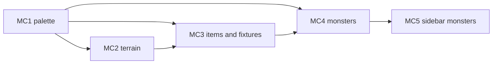

# Epic MC: Map Colors

A feature epic, not a port. It colors the map and the visible-monsters
sidebar:

* Cave walls, floors, corridors, and town buildings get terrain colors.
* Doors, stairs, rubble, traps, shop entrances, and items get colors by type.
* Every monster template carries its own color, used on the map, in spell
  and missile animations, and in the sidebar.
* The palette uses 256 colors where the terminal has them and falls back to
  the 8 basic colors (plus bold) elsewhere.

Back to the [backlog](../backlog.md).

Every story here changes what the player sees, so each one adds a
`CHANGELOG.md` bullet unless its card says it preserves behavior. Backlog
rules still apply: keep every C ABI and test the logic without a terminal.

## Current Flow

Checked against source on 2026-10-30.

| Piece | Today | Source |
| --- | --- | --- |
| Color setup | `start_color()` and six pairs (red, green, yellow, blue, magenta, cyan) on black. The pair number equals the `COLOR_*` constant. No `has_colors()` or `COLORS()` check. | `init_curses` in [ncurses.rs](../../../src/ncurses.rs) |
| Pair helper | `color_pair(pair)` wraps `COLOR_PAIR` | [ncurses.rs](../../../src/ncurses.rs) |
| Map glyph | `loc_symbol` returns one `chtype` per cell. Only water is colored (`` '`' `` with blue). Walls are `#`, floors `.`, unknown terrain `.` with `A_DIM`. | [misc.c](../../../src/misc.c) |
| Terrain | `cave[y][x].fval` from `enum floor_types`; sets `water_set`, `earth_set`, `pwall_set` | [floor.h](../../../src/floor.h), [variables.c](../../../src/variables.c) |
| Town buildings | `gc__build_store` fills the building with `ft_boundry_wall`, the same value as the town and dungeon border | [town.c](../../../src/generate_map/town.c) |
| Item glyph | `symbol()` maps `ItemType` and subval to a `chtype`. Doors, stairs, rubble, traps, and shop entrances are `ItemType` values. Shop entrances already add `A_BOLD`. | [item_type.rs](../../../src/data/item_type.rs), `C_item_get_tchar` in [data/interop.rs](../../../src/data/interop.rs) |
| Item glyph as text | `inven.c` formats the glyph with `%c` and compares it as `char` | [inven.c](../../../src/inventory/inven.c) |
| Monster glyph | `monster_template_get_symbol` returns a plain `char`. `MonsterTemplate` has no color. About 390 literals in `data.rs`. | [monster_template/](../../../src/generate_monster/monster_template/) |
| Direct monster prints | These call `print()` with the plain symbol, bypassing `loc_symbol` | `creature.c`, `spells.c`, and `ranged.c` (a missile item) |
| Sidebar monsters | `render_monsters_panel` builds `"{symbol} {name} ({count})"` strings. `draw_lines` hands the sink a `&str` with no attributes. | [sidebar.rs](../../../src/user_interface/sidebar.rs), [layout.rs](../../../src/user_interface/layout.rs) |
| Tests | HUD `stat_color` test; file-backed `TestScreen` tests in `ncurses.rs`; `get_loc_symbol` checks in `tests/headless_turn.c` (only for `@`). None checks map colors. | |

The constraints the stories depend on:

* **Glyphs are `chtype`.** Attribute bits already travel with the character
  through `loc_symbol`, `print`, and `print_chstr` (shop entrances use
  `A_BOLD`). Callers that need only the character must mask it:
  `files.c` already uses `& 0x7F`.
* **`C_item_get_tchar` feeds text.** Adding color there would leak attribute
  bits into inventory prompts, so the colored glyph is a new function.
* **Matching code needs the plain symbol.** `spells.c` compares a monster
  symbol to a typed character and `files.c` prints it in the monster
  recall. These keep `monster_template_get_symbol`.
* **Pair numbers 1-6 are taken** by the HUD (`stat_color` and status
  fields). New pairs start at 16.
* **Two functions edit the same file.** MC2, MC3, and MC4 all change
  `loc_symbol` in `misc.c`, so they run in order.
* **Hallucination and blindness** are handled before the glyph is chosen
  (`loc_symbol` returns a space when blind), so colors never leak through.
* **No remembered tiles.** `get_loc_symbol` returns a space for cells that
  are not currently lit, so there is nothing to dim.

## Target Design

The shape the stories build:

* **Semantic roles, not color numbers.** A `MapColor` enum names each role
  (for example `Water`, `Granite`, `Magma`, `Quartz`, `BoundaryWall`,
  `RoomFloor`, `Corridor`, `Door`, `Stairs`, `Rubble`, `Trap`, `ShopEntrance`,
  `Gold`, `Potion`, `Scroll`, `Weapon`, `Armor`, and one per monster
  color). Game code asks for a role and receives an attribute.
* **One table, two palettes.** Each role maps to a 256-color index and an
  8-color fallback (color plus optional bold). `init_map_colors(color_count)`
  picks the column from `COLORS()` and registers one pair per role from pair
  16 up. With no color support the attribute is empty.
* **Pure mappings.** `fval` to role, `ItemType` and subval to role, and role
  to colors are plain functions with no curses calls, so each is an L0 test.
* **C asks through small shims.** `*_extern.rs` exports return a `chtype`
  with the color bits ORed in. C never sees pair numbers.
* **Monsters own their color.** `MonsterTemplate.color` is data, set per
  monster. Map, animations, and sidebar read the same field.
* **The sidebar draws cells, not just strings.** The monsters panel draws the
  symbol with its attribute, then the rest of the line plain.

## Decisions

All decided on 2026-10-30.

### MCD1. Palette

Decision: 256-color with an 8-color fallback, chosen at startup from
`COLORS()`.

### MCD2. Monster Colors

Decision: a color field on every `MonsterTemplate`, assigned per monster,
not derived from the symbol letter.

### MCD3. Scope

Decision: walls, floors and corridors, town buildings and shop entrances,
doors, stairs, rubble, traps, monsters, and items by type.

### MCD4. Color Option

Decision: no on/off setting. Terminals without color support get no color
attributes.

### MCD5. Sidebar

Decision: the visible-monsters panel uses the same colors as the map.

## Story Graph

Ordering notes:

* MC1 is the pathfinder. MC2 to MC5 use its role table and attribute
  lookup without changing their signatures.
* MC2, MC3, and MC4 all edit `loc_symbol` in [misc.c](../../../src/misc.c)
  and run in that order, never at the same time. Their other files are
  disjoint, so the Rust halves can be prepared in parallel and only the
  `misc.c` hook-up waits.
* MC5 follows MC4 because it reads `MonsterTemplate.color`.

## Stories

### MC1. Palette and Attribute Lookup (pathfinder: F-PALETTE)

Status: done (2026-10-30). Depends on: none.
Size: M. Complexity: Medium. Agent: strong.

Implementation: `MapColor` (32 roles, including monster colors) and the role
table are in [map_colors.rs](../../../src/user_interface/map_colors.rs);
`init_curses` calls `init_map_colors`. Water in `loc_symbol` now uses the new
`C_map_color_water_attr` shim (`map_colors.h`, `map_colors_extern.rs`), the
only `misc.c` change. Water uses ANSI blue (index 4) so 256-color terminals
match today's look. Verification: L0 and L1 tests (`cargo test --lib
map_colors`, `ncurses::tests`). Unverified: C-level `loc_symbol` water output
(left to MC2's L2 tests); real-terminal look.

Owns: [ncurses.rs](../../../src/ncurses.rs), a new
`src/user_interface/map_colors.rs` for the role table (and its module
registration). Must not touch: `misc.c`, item and monster data, sidebar.

Behavior:
* Add the `MapColor` role enum and the role table with a 256-color index and
  an 8-color fallback (color and bold) per role.
* Add `init_map_colors(color_count)` and `map_color_attr(role) -> chtype`.
  Pairs start at 16 and use a black background. Existing pairs 1-6 are
  untouched.
* Call it from `init_curses` after `start_color()`. If `has_colors()` is
  false, `map_color_attr` returns an empty attribute.
* Re-express water as `MapColor::Water` with the same visible result on an
  8-color terminal.

Foundation: F-PALETTE.
* `MapColor`, the role table, `init_map_colors`, and `map_color_attr`.

Acceptance checks:
* L0: every role has a 256-color value and a fallback; no fallback is black
  on black.
* L0: 256-color and 8-color selection from a color count; no color support
  gives an empty attribute.
* L1, file-backed `newterm()` with an 8-color and a 256-color terminal type:
  `COLORS()` matches, and an attribute written with `map_color_attr` reads
  back with the same pair through `mvinch`.
* Changelog: none (water keeps today's look).

Out of scope: any `loc_symbol` change except the water re-expression.

### MC2. Terrain Colors (fan-out)

Status: done (2026-10-30). Depends on: MC1.
Size: S. Complexity: Low. Agent: standard.

Owns: a new terrain-role function and its extern shim (module
registration in `lib.rs` or the owning `mod.rs`), and the wall, floor, and
water branches of `loc_symbol` in [misc.c](../../../src/misc.c). Must not
touch: item and monster branches of `loc_symbol` (MC3, MC4), palette
internals (MC1).

Behavior:
* Map `fval` to a role: granite, magma, and quartz walls each their own;
  boundary wall one color (town buildings and the border share it); room
  floor and corridor floor subtle, distinct colors; water as today.
* `loc_symbol` ORs the terrain attribute into the `#` and `.` results. Unknown
  terrain stays `.` with `A_DIM`.
* Glyph characters do not change.

Acceptance checks:
* L0: every `fval` in `pwall_set`, `earth_set`, and `water_set` maps to the
  expected role; an unknown `fval` maps to no role.
* L2, C headless: `get_loc_symbol` for a granite wall, a magma vein, a floor,
  and a boundary wall returns the expected character in the low byte and the
  expected pair bits, and still returns `@` for the player.
* Changelog entry: cave walls, floors, and town buildings are colored.

Implementation: `terrain_color(FloorType)` maps the existing typed terrain
variants to semantic roles. `C_map_color_terrain_attr` converts the C byte with
`FloorType::try_from` at the FFI boundary, keeping raw floor values out of the
role mapping. The shim supplies attributes to `loc_symbol` for wall and floor
glyphs; water keeps its existing shim and appearance. `C_map_color_init` shares
palette initialization with C callers. Unknown terrain and glyph characters
are unchanged.

Verification: `cargo test --lib map_colors` covers every modeled terrain value
in the wall, earth, and water sets. The file-backed 8-color and 256-color tests
verify typed terrain attributes against registered role pairs; `make test-headless`
verifies C glyph bytes and expected pair bits with a file-backed 256-color
screen, including the hidden-monster terrain fallback and player glyph.
`CARGO_TERM_QUIET=true make -s check` passed (933 Rust tests and all available
C/headless checks).

Unverified: real-terminal visual appearance; `test-traps` requires Linux GNU
ld `--wrap` and was skipped on macOS.

Out of scope: items, doors, and monsters.

### MC3. Items and Fixtures (fan-out)

Status: done (2026-10-30). Depends on: MC1, MC2 (for `misc.c` order).
Size: M. Complexity: Medium. Agent: standard.

Owns: `color(item_type, subval)` in [item_type.rs](../../../src/data/item_type.rs),
`C_item_get_glyph` in [data/interop.rs](../../../src/data/interop.rs), its C
declaration, the item branches of `loc_symbol`, and the missile print in
[ranged.c](../../../src/combat/ranged.c). Must not touch: `C_item_get_tchar`,
`inven.c`, monster code.

Behavior:
* Map every `ItemType` to a role: doors (open and closed), up and down
  stairs (steep included), rubble, traps (seen traps only; unseen traps and
  secret doors keep the glyph they show today), each shop entrance, gold,
  gems and jewelry, potions, scrolls and books, weapons, armor, food, and
  the rest.
* Shop entrances keep `A_BOLD` and gain a color.
* `C_item_get_glyph` returns the glyph with the color attribute.
  `C_item_get_tchar` stays unchanged for text callers.
* `loc_symbol` and the thrown-missile print use the glyph variant.

Acceptance checks:
* L0: every `ItemType` maps to a role (a test that fails when a variant is
  added without one); door, stair, rubble, trap, and each shop entrance
  subval give the expected role.
* L0: `C_item_get_tchar` output is unchanged for every `ItemType`.
* L2, C headless: `get_loc_symbol` for a cell holding a closed door, a
  down staircase, and a potion returns the expected character and color bits.
* Changelog entry: doors, stairs, traps, shops, and items are colored.

Out of scope: inventory and equipment text; item names.

Implementation: `color` exhaustively maps item types to semantic roles, and
`glyph` combines the unchanged plain symbol with the registered role
attribute. Unseen traps and secret doors keep their current uncolored glyphs.
`C_item_get_glyph` is a separate C API used by map and missile rendering;
`C_item_get_tchar` remains the text-only API.

Verification: `cargo test --lib data::item_type::tests` checks role coverage,
fixture roles, preserved glyph bytes, and shop bold. The interop test checks
`C_item_get_tchar` against the plain symbol for every renderable item type
(`Whirlpool` retains its existing non-renderable panic). `make test-headless`
checks closed-door, downstairs, and potion glyph bytes and pair bits, as well
as uncolored unseen traps and secret doors. `make check-fast` passed, and
`CARGO_TERM_QUIET=true make -s check` passed (937 Rust tests and all available
C/headless harnesses).

Unverified: real-terminal color appearance and the in-game missile animation
path; the headless harness verifies map rendering, while the missile caller is
covered by compilation and linking. On macOS, `test-traps` was skipped because
GNU `ld --wrap` is unavailable.

### MC4. Monster Colors (fan-out)

Status: open. Depends on: MC1, MC3 (for `misc.c` order).
Size: L. Complexity: Medium. Agent: standard.

Owns: [monster_template/](../../../src/generate_monster/monster_template/)
(`template.rs`, `data.rs`, `interop.rs`, tests),
`monster_template.h`, the monster branch of `loc_symbol`, and the direct
`print()` calls in [creature.c](../../../src/creature.c) and
[spells.c](../../../src/spells.c). Must not touch: sidebar (MC5),
`monster_template_get_symbol` callers that match or print the character.

Behavior:
* Add `color: MapColor` to `MonsterTemplate`; update `GLITCH_TEMPLATE`, the
  test helper, and every literal in `data.rs`. Assign a color per monster
  and review the assignments by hand.
* Add `monster_template_get_glyph(index) -> chtype` (symbol plus color) and
  declare it in `monster_template.h`.
* `loc_symbol` and the direct prints in `creature.c` and `spells.c` use it, so
  a monster keeps its color during movement and spell animations.
* `monster_template_get_symbol` is unchanged.

Acceptance checks:
* L0: every template has a color other than black; the glitch template
  gets a defined color.
* L0: `monster_template_get_glyph` low byte equals
  `monster_template_get_symbol` for every index, and an out-of-bounds index
  behaves like the symbol accessor does today.
* L2, C headless: a visible monster in a lit cell returns its symbol with
  its color bits from `get_loc_symbol`; an unseen monster still shows the
  terrain or item under it.
* Changelog entry: monsters are colored.

Out of scope: monster recall text; the sidebar.

### MC5. Sidebar Monster Colors (fan-out)

Status: open. Depends on: MC4.
Size: S. Complexity: Medium. Agent: standard.

Owns: the monsters panel in [sidebar.rs](../../../src/user_interface/sidebar.rs)
and the attribute-capable draw path it needs in
[layout.rs](../../../src/user_interface/layout.rs). Must not touch: the
equipment and inventory panels, mouse hit testing.

Behavior:
* The visible-monsters panel draws each monster's symbol with the same
  attribute the map uses, then the name and count plain.
* Row text, ordering, grouping, truncation, and the blind and hallucination
  blanking stay as they are. Panel text assertions keep passing.
* Hover and click handling read the panel rows by position and do not
  change.

Acceptance checks:
* L0: the rendered lines are identical to today's, and a separate per-row
  attribute list reports the symbol cell with the template color.
* L0: blind and hallucinating panels carry no attributes.
* L1, file-backed `newterm()`: the symbol cell of a monster row reads back
  with the expected pair, and the rest of the row has none; check the panel at
  a split size and at the minimum size.
* Changelog entry: the visible-monsters panel uses the map colors.

Out of scope: coloring names; the equipment and inventory panels.

## Remaining Gaps

* **Remembered tiles.** Cells that are not lit show as blanks, so
  dimming remembered walls is a separate feature.
* **Lava and trees.** Neither exists in the game, so no role is defined.
* **Inventory and equipment.** These panels show names without glyphs and
  stay uncolored.
* **Color blindness and light terminals.** The palette assumes a dark
  background; no contrast setting is planned (MCD4).
* **Real-terminal check.** Pair attributes are tested with file-backed
  screens; how the colors look in a real 8-color and 256-color terminal is
  a manual check.
