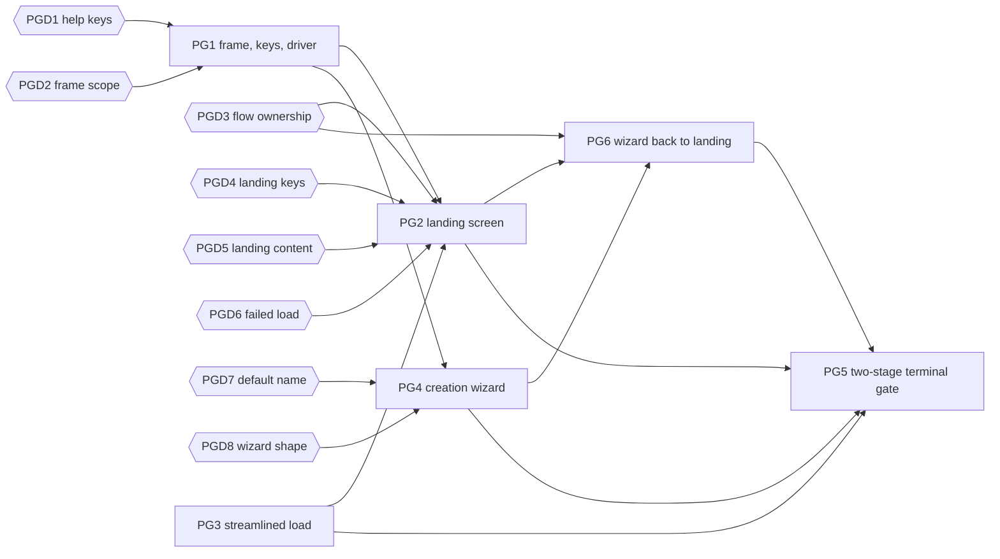

# Epic PG: Pre-Game Menu

A feature epic, not a port. It rebuilds the screens between program start
and the game loop:

* One landing screen replaces the banner, the highscore overlay, and the
  character list.
* Character creation becomes a wizard with working back navigation.
* All pregame screens share one menu frame, one key model, and one input
  loop.
* Menus render at 80x24 and up; the 150x25 gameplay minimum is only
  enforced when the game starts.

Back to the [backlog](../backlog.md).

Every story here changes what the player sees or presses, so each one adds
a `CHANGELOG.md` bullet unless its card says it preserves behavior.
Backlog rules still apply: keep every C ABI, draw through Rust, and test
the logic without a terminal.

Several stories wait on a design decision. The [Decisions](#decisions)
section lists them; story cards are written against the recommended option
and say what changes if another option is chosen.

## Current Flow

Checked against source on 2026-10-26.

| Step | Screen | Key needed | Source |
| --- | --- | --- | --- |
| Terminal gate | Waits until 150x25 before anything draws | resize | `C_wait_for_usable_terminal` in [term.c](../../../src/term.c), called from `init_curses` in [ncurses.rs](../../../src/ncurses.rs) |
| Banner | Copyright, title, version | any key | `print_banner` in [menu.rs](../../../src/pregame/menu.rs) |
| Highscores | All characters, paged overlay | Escape (Space pages) | `show_highscore` in `menu.rs`, `draw_help_vec` in [logic/menu.rs](../../../src/logic/menu.rs) |
| Character list | Saved characters, `n` for new | Enter | `main_menu` in `menu.rs` |
| Rename stop | Loaded characters only | Escape to skip | `change_name` in [create_character.rs](../../../src/pregame/create_character/create_character.rs), called from `load_existing_character` in [main.c](../../../src/pregame/main.c) |
| Creation | race, sex, stats, history, class, confirm and name | Enter per step | `create_character` in `create_character.rs`, called from `create_new_character` in `main.c` |

The constraints the stories depend on:

* **Sequencing lives in C.** `pregame__main` calls `pregame__menu` (Rust),
  then either `load_existing_character` or `create_new_character`, which
  calls Rust `create_character()` (returns nothing). A failed load returns
  `false`, and [main.c](../../../src/main.c) calls `exit_game()`.
* **Creation has no way back.** The creation key loops ignore Escape
  (`_ => {}`); changing your mind means quitting the game.
* **Creation writes globals as it goes.**
  * `player::set_race`, `set_sex`, `set_class`, `apply_stats_from_race`,
    `apply_stats_from_class`, `generate_and_apply_money`, and
    `generate_and_apply_equipment` in
    [logic.rs](../../../src/pregame/create_character/logic.rs) write player
    state step by step. Money and equipment go through C `add_money` and
    `add_inven_item`.
  * Later steps also *read* those globals: `generate_stats_from_race` rolls
    history from `player::race()` instead of its `race` argument,
    `choose_sex` checks `player::race()` for Dryad, and `choose_class` lists
    classes for `player::race()`.
  * The confirm screen shows `player::max_hp()`, which only has a value after
    the class is applied, and `max_mp()`, which is always 0 there because
    `learn_magic` runs later in C.
  * Stat rolls use `rng::randint` and item generation uses `thread_rng`, so
    today's sequence cannot be replayed from a seed.
* **Name entry.** `term::get_string` wraps C `Get_String` and loops until the
  result is non-empty; Escape also returns empty, so it re-prompts. Empty
  names are impossible today. `Get_String` clamps the field to end at
  column 79. No default or random name generator exists.
* **Rename exists in game.** The `C` command in
  [command.c](../../../src/main_loop/command.c) calls `change_name()`, which
  shows the character screen and offers `<c>hange character name`.
* **The menu frame is fixed and shared.** `draw_menu` and
  `draw_menu_with_selection` are hard-coded to 80x24 (`WIDTH`/`HEIGHT` in
  [logic/menu.rs](../../../src/logic/menu.rs)) with 18 content rows. Other
  callers:
  * `display_inventory` in
    [display_inventory.rs](../../../src/inventory/display_inventory.rs)
    pages 20 items at a time, so two rows overwrite the bottom border.
  * `show_class_restrictions` in [commands.rs](../../../src/commands.rs).
  * The Classic `^P` overlay, `show_recorded_messages` in
    [message.rs](../../../src/message.rs) (Split uses the scrollback
    instead).
* **Help overlays.** `draw_help_vec` closes only on Escape; Space pages and
  wraps. When the line count is a multiple of 18 it shows an empty last
  page. Inventory also uses Space for the next page.
* **Input goes through `inkey`.** `io::inkey_flush` calls C `inkey` in
  [term.c](../../../src/term.c), which:
  * handles `KEY_RESIZE` by calling `C_terminal_resize(draw_cave)`, which
    waits for 150x25 and swallows the event, so the caller never redraws;
  * exits the game on end of input while no character exists;
  * feeds the message log input hook.
  `translate_key` in [key_translation.rs](../../../src/key_translation.rs)
  maps arrows to `8`/`2`/`4`/`6`, gives Home, End, Page Up, and Page Down
  named bytes, and drops `KEY_RESIZE`.
* **Size checks have side effects.** `C_terminal_layout_update` in
  [ncurses.rs](../../../src/ncurses.rs) sets the global current layout;
  below 150x25 that is `TooSmall`. `ncurses::mvaddstr` panics on
  out-of-bounds writes.
* **Gameplay drawing starts inside pregame.** The end of `pregame__main`
  calls `clear_from(1)`, `prt_stat_block()`, and `generate_map()`, which
  need the gameplay size.
* **Highscores can crash pregame.** `show_highscore` calls
  `master::read_master().unwrap()`.
* **Credits.** [COPYRIGHT.txt](../../../COPYRIGHT.txt) allows modification
  "as long as the above credits are retained". Today the banner shows them.
* **Available building blocks.** The F-LAYOUT renderer pattern
  (`render_lines`/`draw_lines` in
  [layout.rs](../../../src/user_interface/layout.rs)) and the SL8 key
  mapping are built. `Scrollback::run` in
  [message_log.rs](../../../src/user_interface/message_log.rs) is an
  existing screen input loop. SL10 live resize is implemented.
* **No pregame harness.** The headless targets in the
  [Makefile](../../../Makefile) cover the main loop, not Rust pregame input.
  `make test-mouse-input` shows the file-backed curses pattern.
* **Keyboard only.** Mouse input (F-MOUSE) hit-tests only the in-game map
  and sidebar; pregame gets no mouse handler.

## Target Design

The shape the stories build, assuming the recommended decisions:

* **Rust owns the pregame flow.** The landing screen calls the wizard
  directly, so Escape from the wizard returns to landing without crossing
  FFI. C receives one outcome from `pregame__menu`: load a character, a
  character was created, or quit. C keeps the post-pregame setup
  (`sav__load_character`, `mst__add_character`, `learn_magic`,
  `generate_map`).
* **Screens are state machines.** Each screen has
  `update(&mut State, MenuKey) -> Transition` and a pure
  `render(&State, Size) -> Vec<String>`. One driver loop reads a key,
  updates, and redraws. Screens never call curses or read globals, so every
  transition and every frame is an L0 test.
* **Pregame reads its own keys.** A pregame key source reads curses input
  directly instead of `inkey` and yields a `MenuKey`, including `Resize`
  and `Eof`. Pregame therefore never reaches the 150x25 gate or
  `draw_cave`, and every screen redraws on resize through the driver.
* **A new frame.** The pregame frame and help overlay are new code in
  [user_interface/](../../../src/user_interface). The fixed `draw_menu` stays
  for in-game callers until the TU epic revisits them.
* **Choices are data until confirm.** The wizard builds plain choice data
  and applies it to player state once, in today's order.

## Decisions

Each decision blocks the stories listed under **Blocks**. Record the
outcome on the card (`Decision: ...`) before starting a blocked story. If
the outcome differs from the recommendation, update the affected story
cards first.

### PGD1. Help Overlay Keys

Status: open. Blocks: PG1.

Question: which keys close a help overlay, and which page it? The first
draft had Space close overlays, but Space is the only paging key today.

Options:
* **A.** Enter and Escape close; Space, Page Down, and `j`/Down page
  forward; Page Up and `k`/Up page back. Applies to pregame and the in-game
  `draw_help_vec` users.
* **B.** Enter, Escape, and Space close; only Page Up and Page Down page.
  Faster to dismiss, but players who page with Space lose that.
* **C.** As A, but in-game overlays keep today's keys; only pregame
  overlays change.

Recommendation: A. It keeps Space paging, and fixing the empty last page at
the same time is free.

### PGD2. Frame Scope

Status: open. Blocks: PG1.

Question: does PG1 build a new frame for pregame only, or retrofit
`draw_menu` for every caller?

Options:
* **A.** New frame in `user_interface/`. Pregame uses it; inventory, class
  restrictions, and Classic `^P` keep the fixed 80x24 `draw_menu` until TU.
* **B.** Retrofit `draw_menu`/`draw_menu_with_selection` to size from the
  terminal. PG1 then owns the in-game callers, must fix inventory's 20-row
  page against the frame, and adds changelog bullets for in-game screens.

Recommendation: A. It keeps the in-game blast radius out of a pregame epic.

### PGD3. Flow Ownership

Status: open. Blocks: PG2, PG6.

Question: where does the landing → wizard → landing loop live?

Options:
* **A.** Rust. The landing screen calls the wizard; `pregame__menu`
  returns Load, Created, or Quit, and C no longer calls `create_character()`.
* **B.** C. `pregame__menu` and `create_character` return codes, and a loop
  in `pregame__main` re-enters the menu on Back.

Recommendation: A. Both screens are already Rust; B adds an FFI round trip
for every back step and spreads the flow over two languages.

### PGD4. Landing Keys

Status: open. Blocks: PG2.

Question: what does Escape do on the landing screen, and how does the
player quit?

Options:
* **A.** Escape does nothing on landing; `q` quits. End of input also
  quits.
* **B.** Escape quits after a yes/no confirmation; `q` also quits.
* **C.** Escape quits immediately.

Recommendation: A. Escape means "back" everywhere else, so a player
backing out of the wizard with repeated Escapes should not exit the game.

### PGD5. Landing Content

Status: open. Blocks: PG2.

Question: the landing screen shows a top-N highscore section. How does the
player reach the full list, and where do the credits go?

Options:
* **A.** `h` opens the full highscore list in the help overlay. One credits
  line sits under the title, and `?` opens the full banner text in the help
  overlay.
* **B.** No full list; top-N only. Credits only in the `?` overlay.
* **C.** Keep a separate banner screen before landing.

Recommendation: A. It keeps every piece of today's information one key
away and keeps a visible credit line on the first screen.

### PGD6. Failed Load

Status: open. Blocks: PG2.

Question: what happens when loading a saved character fails?

Options:
* **A.** Return to the landing screen with an error line above the list.
* **B.** Keep today's behavior: print the message and exit the game.

Recommendation: A. With a landing screen, exiting on a corrupt save is
needlessly harsh, and the player may have other characters.

### PGD7. Default Name

Status: open. Blocks: PG4.

Question: should the confirm screen pre-fill a generated name?

Options:
* **A.** No generator. The name field starts empty; Enter on an empty field
  shows a hint and stays on the field.
* **B.** Add a random name generator (per race or generic). The field is
  pre-filled so Enter accepts it. This adds name data and a generator,
  roughly an S story of its own.

Recommendation: A for this epic, with B recorded under Remaining Gaps.

### PGD8. Wizard Shape

Status: open. Blocks: PG4.

Question: step-by-step wizard or one creation form?

Options:
* **A.** Step wizard: race → sex → stats → history → class → confirm. A
  line at the top shows the choices made so far. Escape steps back.
* **B.** One form: race, sex, and class lists side by side, a live stat
  preview, `r` to reroll, Enter to confirm and name. No back navigation is
  needed, but help text and the stat preview are cramped at 80x24.

Recommendation: A. It matches the existing flow and keeps each screen
readable at 80x24.

## Story Graph

Ordering notes:

* PG1 is the pathfinder. PG2, PG4, PG5, and PG6 use its frame, key model,
  and driver without changing their signatures.
* PG3 needs no decision and can start at once, in parallel with PG1.
* PG2 and PG4 own different files and can run in parallel once PG1 merges.
  PG6 connects them afterwards.
* PG3, PG2, PG6, and PG5 all edit [pregame/main.c](../../../src/pregame/main.c)
  and run in that order, never at the same time.
* PG5 is last because it relies on every pregame screen reading keys
  through the PG1 key source; otherwise a resize during pregame still hits
  the 150x25 gate in `inkey`.

## Stories

### PG1. Menu Frame, Key Source, and Driver (pathfinder: F-MENU)

Status: open. Depends on: PGD1, PGD2.
Size: M. Complexity: Medium. Agent: strong.

Owns: new `src/user_interface/menu_frame.rs` and
`src/user_interface/menu_input.rs`, their module registration, and (per
PGD1 A) the key handling and paging in `draw_help_vec` in
[logic/menu.rs](../../../src/logic/menu.rs). Must not touch: pregame screen
content (PG2, PG4), `pregame/main.c` (PG3, PG2, PG6, PG5), other
`draw_menu` callers.

Behavior:
* **Frame.** A pure renderer for a bordered frame with a title, a list or
  text body, a selection highlight, and a hint line. It sizes from the
  terminal, clamps to an 80x24 minimum, and centers. Long lines and long
  lists truncate; lists scroll to keep the selection visible. A thin sink
  draws the rendered rows, including the highlight attribute.
* **Help overlay.** A paged text overlay in the new frame, with the PGD1
  keys. Pages split by the visible body height, with no empty last page.
* **Key model.** `MenuKey`: `Up`, `Down`, `PageUp`, `PageDown`, `Home`,
  `End`, `Select`, `Back`, `Char(u8)`, `Resize`, `Eof`. Arrows and `j`/`k`
  map to `Up`/`Down`, Enter to `Select`, Escape to `Back`, and named keys
  from [key_translation.rs](../../../src/key_translation.rs) to the paging
  keys.
* **Key source.** Reads curses input directly, not through `inkey`, so the
  gameplay size gate, `draw_cave`, and the message log hook are never
  reached. `KEY_RESIZE` becomes `Resize`; end of input becomes `Eof`.
* **Driver.** One loop over a screen's `update` and `render`, with an
  injectable key source and draw sink. On `Resize` it re-reads the size and
  redraws. Below 80x24 it draws a one-line "too small" notice and waits for
  the next resize, without touching the global layout.
* `draw_help_vec` gets the PGD1 keys and the empty-last-page fix, so the
  in-game overlays match.

Foundation: F-MENU.
* The frame renderer and draw sink.
* `MenuKey`, the pregame key source, and the driver with a screen trait
  (`update`, `render`).
* The pregame help overlay.

Acceptance checks:
* L0: frame rendering at 80x24, 150x25, and 200x60: centering, title and
  hint truncation, list truncation, and scroll-to-selection.
* L0: key mapping for arrows, `j`/`k`, Enter, Escape, named keys,
  `KEY_RESIZE`, and end of input.
* L0: driver with a scripted key source and recording sink: redraw on
  resize, the too-small notice below 80x24, and recovery.
* L0: help overlay paging and close keys, including a line count that is an
  exact multiple of the page height.
* Changelog: help overlays close on Enter; paging no longer shows an empty
  last page.

### PG3. Streamlined Load (fan-out)

Status: open. Depends on: none.
Size: S. Complexity: Low. Agent: light.

Owns: `load_existing_character` in [pregame/main.c](../../../src/pregame/main.c).
Must not touch: `create_character.rs` (PG4), `pregame/menu.rs` (PG2).

Behavior:
* Loading an existing character goes straight into the game; the
  `change_name()` call is removed from the load path.
* In-game renaming through the `C` command is unchanged.

Acceptance checks:
* The change is a single call removal in C with no Rust logic, so no L0 test
  applies. Report the game-start path after selecting a character as an
  unverified boundary unless a pregame harness exists.
* Changelog entry.

### PG2. Landing Screen and Pregame Outcome (fan-out)

Status: open. Depends on: PG1, PG3, PGD3, PGD4, PGD5, PGD6.
Size: M. Complexity: Medium. Agent: standard.

Owns: [pregame/menu.rs](../../../src/pregame/menu.rs),
[pregame/menu.c](../../../src/pregame/menu.c), `pregame/menu.h`, the
outcome dispatch at the start of `pregame__main`, and the failure message in
`load_existing_character` (after PG3 merges), both in
[pregame/main.c](../../../src/pregame/main.c). Must not touch:
`logic/menu.rs` and the PG1 files, `create_character.rs` (PG4).

Behavior:
* One landing screen replaces `print_banner`, `show_highscore`, and
  `main_menu`: title and one credits line on top, a top-N highscore
  section, and the saved-character list below.
* Keys (PGD4, PGD5): Up/Down move, Enter loads the selected character, `n`
  creates a new character, `h` opens the full highscore list, `?` opens the
  credits, `q` and end of input quit. Escape does nothing.
* Enter on a character is the only keystroke needed to start loading it.
* With no saved characters the list area says so and hints at `n`; the
  screen does not auto-advance.
* If the master file cannot be read, the highscore section shows a short
  note instead of crashing.
* `pregame__menu` returns an outcome: Load, New, or Quit. On Quit,
  `pregame__main` returns `false`. On New it still calls
  `create_new_character` as today; PG6 moves that into Rust.
* Failed load (PGD6): `pregame__main` re-enters the landing screen with an
  error line instead of exiting. The message moves from `msg_print` to the
  landing screen.

Acceptance checks:
* L0: landing renderer with no saves, a few saves, and more saves than fit;
  the highscore section fitted and truncated at 80x24; a master read error;
  an error line after a failed load.
* L0: update: Enter loads, `n` creates, `q` and `Eof` quit, `h` and `?` open
  overlays, Escape is ignored, and navigation clamps at both ends.
* Changelog entry.

### PG4. Creation Wizard with Back Navigation (fan-out)

Status: open. Depends on: PG1, PGD7, PGD8.
Size: L. Complexity: High. Agent: strong.

Owns: [create_character.rs](../../../src/pregame/create_character/create_character.rs),
[logic.rs](../../../src/pregame/create_character/logic.rs),
[model.rs](../../../src/pregame/create_character/model.rs), and a new
`src/pregame/create_character/wizard.rs`. Must not touch:
`pregame/menu.rs` (PG2), `pregame/main.c`, `create_character/interop.rs`
(PG6), the PG1 files.

Behavior:
* A step machine: race → sex → stats → history → class → confirm. Enter
  advances, Up/Down and `j`/`k` move, `r` rerolls on the stats screen, and
  Escape steps back one screen. Dryads skip the sex screen in both
  directions. Escape on the race screen ends the wizard with `Back`.
* A line at the top of each screen shows the choices made so far.
* Choices are plain data until confirm:
  * Changing race or sex rerolls the stats. Picking the same option again
    keeps the roll. Going back from class keeps the roll.
  * A race change clears the chosen class if the new race cannot take it.
  * `generate_stats_from_race` uses its `race` argument for history, not
    `player::race()`. Same result today, since race is set first.
* The confirm screen shows HP computed from the choices without touching
  player state, and drops the mana line (always 0 today).
* Name entry is a Rust text field in the frame, not `Get_String`. Enter on
  an empty field shows a hint and stays (PGD7). Escape goes back to class.
* At confirm, the choices are applied once, in today's order: race, sex,
  race stats and history, class, class stats, money, name, equipment.
* Help overlays (`?`, `s`, `c`, `r`) use the PG1 overlay.
* Hint text matches the keys (today's hints say `j=up, k=down`).
* Exposes `run_wizard() -> CreationOutcome` (`Created` or `Back`). The C ABI
  `create_character()` keeps working: it loops until `Created`, so Escape on
  race restarts the wizard until PG6 connects it to the landing screen.
* Stat rolls in the step machine come from an injected roller, so tests
  never call `rng::randint`.

Acceptance checks:
* L0: transitions: the forward path, Escape back from every step, the Dryad
  skip both ways, `Back` from race, reroll on race or sex change, the kept
  roll on an unchanged choice and on a revisited class, and the class reset
  on race change.
* L0: renderer output for each wizard screen at 80x24.
* L0: the name field: typing, backspace, the length limit, an empty Enter,
  and Escape.
* L1, serialized: applying a completed choice set produces the expected race,
  sex, class, stats, history, and name in player state, and adds money and
  equipment.
* Changelog entry.

### PG6. Wizard Back to Landing (fan-out)

Status: open. Depends on: PG2, PG4, PGD3.
Size: S. Complexity: Low. Agent: standard.

Owns: the New branch in [pregame/menu.rs](../../../src/pregame/menu.rs),
`create_new_character` in [pregame/main.c](../../../src/pregame/main.c),
and [interop.rs](../../../src/pregame/create_character/interop.rs). Must
not touch: the wizard internals (PG4), the PG1 files.

Behavior:
* On `n`, the landing screen runs `run_wizard`. `Back` returns to the
  landing screen with the previous selection; `Created` returns the Created
  outcome to C.
* `create_new_character` stops calling `create_character()` and keeps the
  rest of its setup (`mst__add_character`, `learn_magic`, seeds).
* The `create_character` C export stays as a wrapper, per the backlog ABI
  rule.

Acceptance checks:
* L0: landing update maps wizard `Back` to the landing state with the
  selection kept, and `Created` to the Created outcome.
* Changelog entry: Escape on the race screen returns to the landing screen.

### PG5. Two-Stage Terminal Gate (fan-out)

Status: open. Depends on: PG2, PG3, PG4, PG6.
Size: M. Complexity: High. Agent: strong.

Owns: `C_wait_for_usable_terminal*` in [term.c](../../../src/term.c) and
`term.h`, the startup call in `init_curses` in
[ncurses.rs](../../../src/ncurses.rs), the gate placement in
`pregame__main` in [pregame/main.c](../../../src/pregame/main.c), and new
`MENU_MIN_ROWS`/`MENU_MIN_COLS` next to the minimums in
[layout.rs](../../../src/user_interface/layout.rs). Must not touch: the
Classic and Split minimums (`CLASSIC_MIN_*`, `SPLIT_MIN_*`), the PG1 driver.

Behavior:
* A menu minimum of 80x24, separate from the gameplay minimums.
* Startup waits only for the menu minimum, through a new C entry that takes
  explicit minimums and does not set the global layout. The existing
  `C_wait_for_usable_terminal` ABI is kept for gameplay.
* The gameplay wait runs in `pregame__main` after load or creation and
  before `clear_from(1)`, `prt_stat_block()`, and `generate_map()`. It
  reuses the SL10 warning-and-wait path and sets the gameplay layout.
* Resizing during pregame is handled by the PG1 driver; nothing in pregame
  calls the gameplay gate.
* The gameplay minimum itself does not change.

Acceptance checks:
* L0: gate decisions: below 80x24 waits at startup; 80x24 up to the
  gameplay minimum runs pregame and then waits before game setup; at or
  above the gameplay minimum it runs straight through.
* L1, file-backed curses as in `make test-mouse-input`: startup at 80x24
  reaches the first pregame frame, and the gameplay wait happens before
  `prt_stat_block`.
* Changelog entry.

## Remaining Gaps

* **Classic gameplay at 80x24.** The stat column plus the 66x22 map do not
  fit in 80 columns, so relaxing the gameplay minimum needs a Classic layout
  redesign in [layout.rs](../../../src/user_interface/layout.rs), or
  dropping Classic in favor of a resizable layout. That decision is outside
  this epic: PG5 reads the gameplay minimum from `layout.rs`, so if it later
  drops to 80x24, the second gate stops doing anything.
* **In-game overlays.** Stores, casino, inventory, class restrictions, and
  Classic `^P` still draw in the fixed 80x24 `draw_menu`. The PG1 frame is
  the base when TU revisits them.
* **Random names.** No name generator unless PGD7 picks option B.
* **Pregame harness.** No headless harness drives Rust pregame input, so the
  path from a pregame selection into game setup stays an unverified boundary
  (PG3, PG6).
* **Mouse in pregame** is deliberately excluded.
