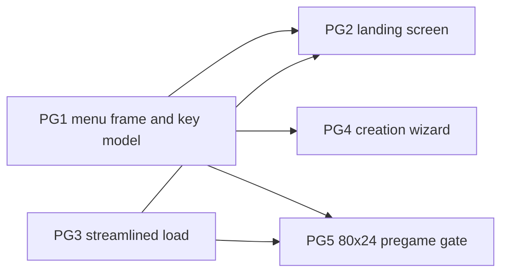

# Epic PG: Pre-Game Menu

A feature epic, not a port. It rebuilds the screens between program start
and the game loop:

* One landing screen replaces the banner, the highscore overlay, and the
  character list.
* Character creation becomes a wizard with working back navigation.
* All pregame screens share one menu frame and one key model.
* Menus render at 80x24 and up; the 150x25 gameplay minimum is only
  enforced when the game starts.

The epic fixes the current "press enter, escape, enter, escape to start a
game" flow. Back to the [backlog](../backlog.md).

Every story here changes what the player sees or presses, so each one adds
a `CHANGELOG.md` bullet unless its card says it preserves behavior.
Backlog rules still apply: keep every C ABI, draw through Rust, and test
the logic without a terminal.

## Current Flow

Checked against source on 2026-10-24.

| Step | Screen | Key needed | Source |
| --- | --- | --- | --- |
| Terminal gate | Waits until 150x25 before anything draws | resize | `C_wait_for_usable_terminal` in [term.c](../../../src/term.c), called from [ncurses.rs](../../../src/ncurses.rs) |
| Banner | Copyright, title, version | Enter | `print_banner` in [menu.rs](../../../src/pregame/menu.rs) |
| Highscores | Top characters, paged overlay | Esc only | `show_highscore` in `menu.rs`, `draw_help_vec` in [logic/menu.rs](../../../src/logic/menu.rs) |
| Character list | Saved characters, `n` for new | Enter | `main_menu` in `menu.rs` |
| Rename stop | Loaded characters only | Esc to skip | `change_name` in [create_character.rs](../../../src/pregame/create_character/create_character.rs), called from `load_existing_character` in [main.c](../../../src/pregame/main.c) |
| Creation | race, sex, stats, history, class, confirm | Enter per step | `choose_race`, `choose_sex`, `choose_stats`, `print_history`, `choose_class`, `confirm_character` in `create_character.rs` |

The constraints the stories depend on:

* The creation screens ignore Escape entirely (`_ => {}` in the key loops).
  There is no way back; changing your mind means quitting the game.
* Each creation step mutates global player state as it runs
  (`apply_stats_from_race`, `apply_stats_from_class`, money and equipment
  generation in [logic.rs](../../../src/pregame/create_character/logic.rs)).
  Back navigation is only safe if choices are held as data and applied
  once, at final confirm.
* `draw_menu`/`draw_menu_with_selection` are hard-coded to 80x24
  (`WIDTH`/`HEIGHT` in [logic/menu.rs](../../../src/logic/menu.rs)) and are
  also used by in-game menus. `draw_help_vec` closes only on Escape and is
  shared with the Classic `^P` overlay in
  [command.c](../../../src/main_loop/command.c).
* `term::get_string` accepts an empty name on Enter, so the confirm step
  loops or produces empty names.
* The F-LAYOUT renderer pattern (`render_lines`/`draw_lines` in
  [layout.rs](../../../src/user_interface/layout.rs)) and the SL8 named
  keys and arrow mapping in [key_translation.rs](../../../src/key_translation.rs)
  are built and available. The `Scrollback::run` input loop in
  [message_log.rs](../../../src/user_interface/message_log.rs) is the
  template for screen input loops.
* Mouse input (F-MOUSE) hit-tests only the in-game map and sidebar. Pregame
  menus are keyboard only; no mouse handler is added.

## Story Graph

Ordering notes:

* PG1 is the pathfinder; PG2, PG4, and PG5 reuse its frame and key model
  without changing their signatures.
* PG3 and PG2 both shape the start sequence, so PG3 lands first. PG3 and
  PG5 both edit [pregame/main.c](../../../src/pregame/main.c) and never run
  at the same time.
* PG2 and PG4 own different files and can run in parallel once PG1 merges.
* PG5 is sequenced last because it moves the terminal-size gate that every
  other screen relies on.

## Stories

### PG1. Menu Frame and Key Model (pathfinder: F-MENU)

Status: open. Depends on: none.
Size: M. Complexity: Medium. Agent: strong.

Owns: [logic/menu.rs](../../../src/logic/menu.rs) and its callers' drawing
setup. Must not touch: pregame screen content (PG2, PG4), `pregame/main.c`
(PG3, PG5).

Behavior:
* `draw_menu` and `draw_menu_with_selection` size and center themselves
  from the actual terminal dimensions instead of the fixed 80x24
  `WIDTH`/`HEIGHT`, clamped to an 80x24 minimum. Content is produced by a
  pure renderer (`Vec<String>` per rect, the F-LAYOUT pattern) and drawn by
  a thin sink.
* One key model for every screen the frame serves: arrows and j/k navigate,
  Enter selects or confirms, Escape backs out or closes.
  `draw_help_vec` additionally closes on Enter and Space, in pregame and in
  the Classic `^P` overlay.
* Named keys from [key_translation.rs](../../../src/key_translation.rs)
  (Home, End, Page Up, Page Down) scroll paged content where it exists.

Foundation: F-MENU.
* A layout-aware menu frame (title, items, selection highlight, hint line)
  with a pure renderer and a draw sink.
* The shared key-model type every pregame screen matches on.

Acceptance checks:
* L0: menu rendering at 80x24, 150x25, and a larger size; truncation and
  centering at each.
* L0: `draw_help_vec` closes on Escape, Enter, and Space; paged content
  scrolls with the named keys.
* Changelog: Enter and Space close help overlays.

### PG2. Landing Screen (fan-out)

Status: open. Depends on: PG1, PG3.
Size: M. Complexity: Medium. Agent: standard.

Owns: [pregame/menu.rs](../../../src/pregame/menu.rs). Must not touch:
`logic/menu.rs` (PG1), `create_character.rs` (PG4), `pregame/main.c` (PG3).

Behavior:
* One landing screen replaces `print_banner`, `show_highscore`, and
  `main_menu`: title art on top, a compact top-N highscore section, and the
  saved-character list below, with `n` creating a new character.
* Enter on a character starts loading it. This is the first and only
  keystroke needed to start the game with a selected character.
* With no saved characters the list area says so and hints at `n`; the
  screen does not auto-advance.
* The screen scales from 80x24 up, through the PG1 frame.

Acceptance checks:
* L0: landing renderer with no saves, few saves, and a list longer than the
  screen; highscore section fitted and truncated at 80x24.
* L0: key handling — Enter loads, `n` creates, arrows and j/k move.
* Changelog entry.

### PG3. Streamlined Load (fan-out)

Status: open. Depends on: none.
Size: S. Complexity: Low. Agent: standard.

Owns: `load_existing_character` in [pregame/main.c](../../../src/pregame/main.c)
and `change_name` in [create_character.rs](../../../src/pregame/create_character/create_character.rs).
Must not touch: `logic/menu.rs` (PG1).

Behavior:
* Loading an existing character goes straight into the game; the
  `<c>hange character name` stop is removed from the load path.
* `change_name`/`choose_name` stay available inside character creation.
* Out of scope: an in-game rename command.

Acceptance checks:
* L1: a scripted-input check (or a harness-level assertion) that loading a
  saved character from the menu takes exactly one Enter and reaches game
  state setup.
* Changelog entry.

### PG4. Creation Wizard with Back Navigation (fan-out)

Status: open. Depends on: PG1.
Size: L. Complexity: High. Agent: strong.

Owns: [create_character.rs](../../../src/pregame/create_character/create_character.rs)
and [logic.rs](../../../src/pregame/create_character/logic.rs). Must not
touch: `pregame/menu.rs` (PG2), `logic/menu.rs` (PG1).

Behavior:
* `create_character()` becomes a step machine:
  race → sex → stats → history → class → confirm/name. Enter advances,
  arrows and j/k navigate, and Escape steps back one screen. Escape on the
  race screen returns to the landing flow.
* Choices are held as plain data during the wizard and applied to global
  player state once, at final confirm. Stepping back and changing race or
  sex rerolls stats; stepping back from class keeps the roll.
* The confirm screen pre-fills the generated default name so Enter accepts
  it; empty input no longer loops.
* Help overlays (`?`, `s`, `c`) use the PG1 close keys.
* Stat totals, money, and equipment are identical to today for any given
  sequence of choices — only when they are applied changes.

Acceptance checks:
* L0: step-machine transitions — forward path, Escape back from every step,
  Escape to landing from race, reroll on race/sex change, kept roll when
  only class is revisited.
* L0: applying a completed wizard produces the same player stats as the
  current sequential code for a fixed RNG seed.
* L0: renderer output for each wizard screen at 80x24.
* Changelog entry.

### PG5. 80x24 Pre-Game Gate (fan-out)

Status: open. Depends on: PG1, PG3.
Size: M. Complexity: High. Agent: strong.

Owns: `C_wait_for_usable_terminal` and its call sites in
[term.c](../../../src/term.c) and [ncurses.rs](../../../src/ncurses.rs),
the end of `pregame__main` in [pregame/main.c](../../../src/pregame/main.c),
and a menu-minimum constant next to the layout minimums in
[layout.rs](../../../src/user_interface/layout.rs). Must not touch: the
Classic/Split gameplay minimums (`CLASSIC_MIN_*`, `SPLIT_MIN_*`).

Behavior:
* A menu minimum of 80x24, distinct from the gameplay minimums. Startup
  waits only for the menu minimum, so all pregame screens run at 80x24.
* The existing TooSmall wait for 150x25 moves to the end of
  `pregame__main`, just before the game loop starts, reusing the SL10
  warning-and-wait path.
* Resizing during pregame redraws the current screen at the new size;
  below 80x24 the TooSmall wait appears.
* The gameplay minimum itself does not change. Making Classic fit 80x24
  needs a layout redesign and is recorded under Remaining Gaps.

Acceptance checks:
* L0: gate logic — below 80x24 waits at startup; 80x24 to 149x24 runs
  pregame and waits before the game loop; 150x25 and up runs straight
  through.
* L1: a resize during pregame (scripted, file-backed curses as in
  `make test-mouse-input`) redraws the menu and never reaches the game
  loop's size check early.
* Changelog entry.

## Remaining Gaps

* Classic gameplay at 80x24: the stat column plus the 66x22 map do not fit
  in 80 columns, so relaxing the gameplay minimum needs a Classic layout
  redesign in [layout.rs](../../../src/user_interface/layout.rs). PG5 only
  moves the gate; it does not redesign the layout.
* In-game full-screen overlays (stores, casino, help) still draw at fixed
  80x24. The PG1 frame is the obvious base when they are revisited; that
  work belongs to the TU epic.
* No in-game rename command; renaming exists only inside character
  creation.
* Mouse support in pregame menus is deliberately excluded.
