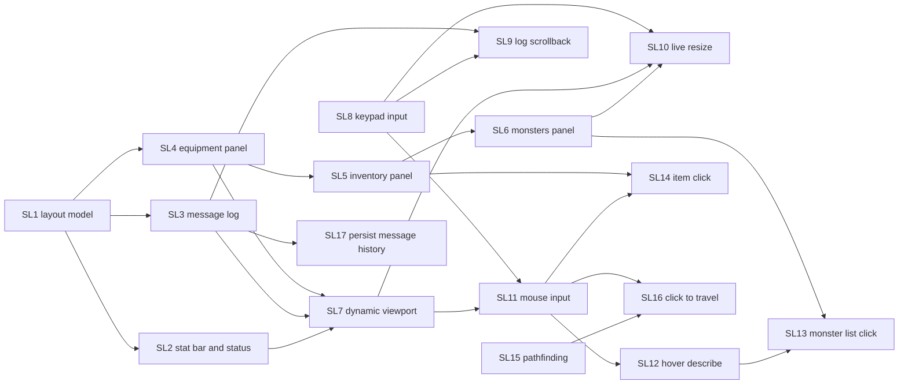

# Epic SL: Split-Screen Layout

A feature epic, not a port. It reorganizes the terminal screen into panels:

* The map sits in the upper left.
* A compact stat bar, a status row, and a scrolling message log sit under it.
* The right sidebar holds equipment, inventory, and visible monsters.
* Mouse input is added on top.

The idea comes from the
[UI overhaul proposal](../../proposals/overhaul-ui.md#terminal-split-screen),
and the layout is modeled on
[Sil](https://www.amirrorclear.net/flowers/game/sil/screen4.png).
Back to the [backlog](../backlog.md).

Most stories here change what the player sees. Each one adds a
`CHANGELOG.md` bullet unless its card says it preserves behavior. Backlog
rules still apply: keep every C ABI, draw through Rust, and test the logic
without a terminal.

## Current Layout

Checked against source on 2026-10-20. Rows and columns are 0-based screen
positions.

| Area | Position | Source |
| --- | --- | --- |
| Prompt and message line | Row 0, with `-more-` | `msg_print` in [io.c](../../../src/io.c), `msg_line` |
| Stat column | Columns 0-13: race, class, HP, mana, quests, gold, bulk, game time | [heads_up_display.rs](../../../src/user_interface/heads_up_display.rs) |
| Map | 66x22 at rows 1-22, columns 14-79 | `SCREEN_WIDTH`/`SCREEN_HEIGHT` in [screen.h](../../../src/screen.h), `s__panel_bounds` in [move.c](../../../src/player_action/move.c) |
| Equipment | Column 81 and up, from row 1 | `EQUIP_COL` in `heads_up_display.rs` |
| Status rows | Rows 23-24: hunger, blind, confused, afraid, poisoned, searching/resting, quest, depth, light off | status `prt_*` in [screen.c](../../../src/screen.c), `print_depth` in `heads_up_display.rs` |
| Minimum terminal | 150x25, otherwise exit | `CLASSIC_MIN_COLS`/`CLASSIC_MIN_ROWS` in [layout.rs](../../../src/user_interface/layout.rs), checked by [ncurses.rs](../../../src/ncurses.rs) |

The constraints the stories depend on:

* `SCREEN_WIDTH`/`SCREEN_HEIGHT` have two meanings.
  * **Viewport:** panel bounds and scrolling in `move.c`, and
    `max_panel_rows`/`max_panel_cols` in
    [generate_map.c](../../../src/generate_map/generate_map.c). These become
    dynamic.
  * **Room grid:** room counts in `dungeon.c`, `dungeon_light_room` in
    [light.c](../../../src/dungeon/light.c), `unlight_area` in `spells.c`,
    and `quart_height`/`quart_width` in `variables.c`. These stay as they are,
    so dungeon size and room layout do not change.
* `panel_row_prt = panel_row_min - 2` and `panel_col_prt = panel_col_min - 15`
  hard-code the map origin. `print`, `print_str`, and `print_chstr` convert
  map coordinates through these values. `used_line[24]` and `clear_rc`
  (rows 2-23) assume 24 rows. `prt_map` erases from column 14.
* Prompts call `prt(prompt, 1, 1)` and `erase_line(msg_line, ...)` directly in
  many C files. Row 0 therefore stays a reserved prompt line in every layout.
* Rust `MESSAGE_RECORD` in [message.rs](../../../src/message.rs) keeps the last
  50 messages as text-and-turn records (SL3). Capture streams stay raw text. `^P` in
  [command.c](../../../src/main_loop/command.c) shows them in a paged
  full-screen overlay (`draw_help_vec`). Message capture bypasses drawing.
* `prt_stat_block` and `prt_equipment` already run every tick from
  [main_loop.c](../../../src/main_loop/main_loop.c), so sidebar panels can
  redraw from the same hook.
* `inkey` in [term.c](../../../src/term.c):
  * It returns `char` and silently consumes `^R`.
  * Keypad mode is not enabled, so arrow keys arrive as raw escape
    sequences.
  * With keypad mode on, curses key codes above 255 would be truncated, for
    example `KEY_UP` (259) becomes 3, which is `^C`. `KEY_RESIZE` and
    `KEY_MOUSE` are also above 255. All of these must be handled before the
    value is truncated.
* [look.rs](../../../src/player_action/look.rs) already describes monsters and
  objects through a `LookContext` (`monster_name`, `item_name`).
* The character screen
  ([character_screen.rs](../../../src/user_interface/character_screen.rs))
  shows race, class, level and XP, HP, mana, AC, and gold. It does not show
  quests, bulk, or game time.
* The current code has no monster memory/recall system and no pathfinding.
* Panel state and message history are not currently saved. SL17 adds message
  history to character saves; other stories leave the save format unaffected.
* HT1 headless doubles in
  [terminal_redirects.h](../../../tests/support/terminal_redirects.h) redirect
  the screen and HUD entry points. New drawing entry points called from C
  need matching redirects, or the headless harnesses stop linking.

## Layouts

`compute_layout(rows, cols)` selects one of three layouts:

* **Classic:** today's screen, unchanged. Used when the terminal is at least
  150x25 but too small for Split.
* **Split:** Classic plus panels in space that is free today. Used when the
  terminal fits the Split minimums set in SL1. There is no layout switch;
  the terminal size decides.
* **TooSmall:** below 150x25. The game exits at startup as it does today,
  until SL10 replaces that with a waiting screen.

## Rollout: Grow From Classic

Every merged story leaves a working screen. The epic never has a state where
panels overlap the map.

**Invariant:** until SL7, the map stays 66x22 at rows 1-22 and columns 14-79.
Every panel goes into space that is free with the map there:

* The log goes at row 25 and below.
* The sidebar goes at column 81 and up, below the equipment.
* The stat bar and status row reuse rows 23-24, which frees the left stat
  column.

SL7 runs after the panels around the map are in their final places. It then
moves the map to column 0 and lets it grow to fill the remaining space.

Split while the map is still fixed (after SL2-SL6):

```text
col 0         14                          80 81
+-------------+----------------------------+-------------------------+
| prompt line (row 0)                       | Equipment               |
+-------------+----------------------------+-------------------------+
| (empty      |                            | Inventory               |
|  after SL2) |      map 66x22             |                         |
|             |                            +-------------------------+
|             |                            | Visible monsters        |
+-------------+----------------------------+                         |
| stat bar: HP 45/60  Mana 10/20  (row 23)  |                         |
| status: Hungry Blind ... Depth (row 24)   |                         |
+-------------------------------------------+                         |
| message log (row 25 and below)            |                         |
+-------------------------------------------+-------------------------+
```

Final Split, after SL7:

```text
+--------------------------------------------+-----------------------+
| prompt line                                | Equipment             |
+--------------------------------------------+-----------------------+
|                                            | Inventory             |
|            map viewport                    |                       |
|      (all remaining rows and columns)      +-----------------------+
|                                            | Visible monsters      |
+--------------------------------------------+                       |
| stat bar: HP, Mana                         |                       |
| status: flags, depth, light                |                       |
+--------------------------------------------+                       |
| message log (fixed height)                 |                       |
+--------------------------------------------+-----------------------+
```

Stories that change the input layer (SL8, SL10, SL11) also affect Classic.
They carry key-sequence regression checks.

## Story Graph



Ordering notes:

* SL4 → SL5 → SL6 is a solid chain because the three panels share the
  sidebar code.
* SL7 waits for SL2, SL3, and SL4 so that the map only grows once the
  surrounding panels are in their final places (the rollout invariant).
* SL8, SL10, and SL11 all edit `inkey` and `ncurses.rs`. They never run at
  the same time: SL8 comes first, and SL10 starts after SL11 merges.
* Only SL1, SL2, and SL7 edit `layout.rs`, and they run one after another.
  Other stories read their rects. A story that needs a different rect size
  stops and reports a scope change.
* SL8 and SL15 have no dependencies and can start at any time.
* SL17 needs SL3 but does not wait for SL9. SL9 and SL17 share message history
  code and must not be implemented concurrently.

## Stories

### SL1. Layout Model (pathfinder: F-LAYOUT)

Status: implemented. Depends on: none.
Size: M. Complexity: Medium. Agent: strong.

Owns: a new `src/user_interface/layout.rs`, `user_interface` module
registration,
[heads_up_display.rs](../../../src/user_interface/heads_up_display.rs),
and startup layout initialization/bounds in [ncurses.rs](../../../src/ncurses.rs).
Must not touch: C files.

Behavior:
* A pure `compute_layout(rows, cols) -> Layout` that returns Classic, Split,
  or TooSmall, with a rect for every area.
* Split rects follow the grow-from-Classic invariant:
  * prompt, map, stat column, status rows, and equipment are in their
    Classic positions;
  * the log is at row 25 and below, over columns 0-80;
  * inventory and monsters are in the sidebar below equipment.
* The HUD reads its positions from the current layout instead of its own
  constants. The screen does not change, because every rect a drawer uses is
  in its Classic position. No changelog entry.

Foundation: F-LAYOUT.
* `Rect` and `Layout` types, and `compute_layout`.
* A process-wide current layout with a test reset.
* The pattern every panel uses: a pure renderer turns a snapshot into
  `Vec<String>` sized to its rect, and a thin function draws those lines with
  ncurses.
* The Split minimum sizes and the sidebar section heights are named
  constants here.

Acceptance checks:

* L0: 150x25 selects Classic, with rects equal to today's positions.
* L0: sizes below 150x25 select TooSmall. Sizes at or above the Split
  minimums select Split.
* L0: Split rects do not overlap, stay inside the terminal, and keep the map
  rect at 66x22 from column 14.
* L0: the renderer pattern truncates and pads lines to the rect width.

Out of scope: drawing anything new, resizing.

Implementation notes:

* [layout.rs](../../../src/user_interface/layout.rs) is exposed as
  `omoria::layout`. `Rect` uses zero-based rows/columns and width/height;
  unavailable panels are `None`, including every panel in TooSmall.
* Classic starts at 150x25. Split starts at 150x35: the log has at least
  10 rows, equipment has 14 rows, inventory has 10 rows, and monsters get
  the remaining sidebar rows (at least 10). Log and monsters grow vertically;
  the sidebar grows horizontally from column 81.
* `current_layout`/`set_current_layout` share a process-wide layout, defaulting
  to Classic 150x25 for callers without a terminal. Tests that change it use
  `serial_test` and `reset_current_layout`.
* Panel renderers take snapshots and use `render_lines` to truncate/pad to
  their rect. `draw_lines` accepts an ncurses sink or a recording test sink.
  Text must use single-cell characters; UTF-8 characters are not split.
* [ncurses.rs](../../../src/ncurses.rs) initializes the layout from the actual
  startup dimensions and checks drawing coordinates against the actual
  terminal bounds. Startup below 150x25 still exits; live resize is deferred.
* The HUD keeps its existing field text, colors, and relative offsets, but
  reads panel origins and stat-column width from the layout. No new panels
  are drawn, and no C files or ABI entry points change.

### SL2. Stat Bar and Status Row (fan-out)

Status: implemented; Rust renderer tests and `make check` pass. L1 character-screen drawing and Split-specific C status callbacks remain unverified. Depends on: SL1.
Size: M. Complexity: Medium. Agent: standard.

Owns: the stat and status functions in `heads_up_display.rs`, the status
`prt_*` functions in [screen.c](../../../src/screen.c), the Split stat and
status rects in `layout.rs`, and
[character_screen.rs](../../../src/user_interface/character_screen.rs).
Must not touch: the equipment functions (SL4).

Behavior:
* In Split, row 23 becomes the stat bar: HP and mana, each as current/max,
  with today's green/yellow/red thresholds. Classes without mana show HP
  only.
* Row 24 becomes the status row: the same flags, depth, and light indicator
  as today.
* The left stat column is removed in Split. Its rect goes away, and columns
  0-13 stay blank until SL7.
* The character screen gains quests, bulk, and game time (day and hh:mm).
  Race, class, gold, and level are already there.
* Classic stays unchanged.

Acceptance checks:

* L0: stat bar text for full, wounded, and critical HP and mana, and for a
  class without mana.
* L0: the status renderer produces each flag, depth, and light state, and
  truncates without splitting a field.
* L1: the character screen shows quests, bulk, and game time.
* Changelog entry.

### SL3. Message Log Panel (fan-out)

Status: implemented. Depends on: SL1.
Size: L. Complexity: High. Agent: strong.

Owns: `msg_print`, `msg_print_pass_one`, and `msg_printf` in
[io.c](../../../src/io.c), [message.rs](../../../src/message.rs),
[term.rs](../../../src/term.rs), a new Rust log panel module, and the
message part of `tests/support`.
The command-accepted hook in
[main_loop.c](../../../src/main_loop/main_loop.c) marks the brightness boundary.
Must not touch: prompt callers that write row 0 directly.

Behavior:
* History entries become records of the text plus the game turn they were
  printed on. Message capture streams stay raw text.
* In Split, messages go to the log rect, newest at the bottom, wrapped to
  its width.
* All messages since the last player command stay bright together, including
  monster actions and status updates across internal game-turn boundaries.
  They dim when the next command is accepted, not while waiting for it.
  Prompt input and `-more-` acknowledgments do not dim messages.
* Consecutive identical messages collapse into one line with a count, for
  example "You miss the orc. (x3)". The collapsing happens only when
  displaying; the history and capture streams keep every message.
* An unseen-message counter resets whenever command input is read. `-more-`
  appears only when the messages of one turn would scroll unseen lines out
  of the log.
* The `msg_print` return value (escape to abort) and message capture keep
  working as today. The prompt line stays on row 0.
* Classic keeps the single line with `-more-`.

Acceptance checks:

* L0: the log renderer wraps, truncates, dims earlier command cycles, collapses
  repeats, and keeps the newest lines visible.
* L0: the overflow rule asks for `-more-` exactly when unseen lines exceed
  the log height. A collapsed repeat counts as one line.
* L1: `make test-messages` passes, with new checks for Split-mode `-more-`
  and for capture still receiving every raw message.
* Changelog entry.

Out of scope: scrollback (SL9), moving prompts off row 0.

Implementation notes:
* [message_log.rs](../../../src/user_interface/message_log.rs) owns the pure,
  bounded display model. Wrapped messages page before unseen lines are lost;
  collapsed repeats are fitted to one row while raw history keeps every entry.
* [term.rs](../../../src/term.rs) bridges the renderer to C drawing/input
  callbacks. Input acknowledgment is reentrant during `-more-`.
* The existing HUD tick hook and screen-clear path redraw the log, so overlays
  do not erase it permanently. Dimming uses an explicit command-accepted signal
  from the main loop, separate from internal game turns and prompt input.
* `make test-messages` enables the `terminal-test-support` feature for headless
  layout selection. It covers Classic compatibility, Split overflow through
  both message entry points, repeat counts, command/turn resets, long-message
  pagination, command-cycle brightness, empty prompt-clearing output, and
  unmodified raw capture.

### SL4. Equipment Panel (fan-out)

Status: implemented; renderer tests and `make check` pass. Depends on: SL1.
Size: S. Complexity: Low. Agent: standard.

Owns: the equipment functions in `heads_up_display.rs` and a new sidebar
module.
Must not touch: the stat and status functions (SL2).

Behavior:
* Equipment drawing moves to the sidebar module and draws into its sidebar
  rect. `C_print_equipment_block` keeps its symbol and becomes the per-tick
  sidebar entry point.
* Item names are truncated to the rect width, and empty slots are kept.
* Classic draws exactly as today.

Acceptance checks:

* L0: the renderer output for a fixed equipment snapshot, including
  truncation.
* L0: the Classic output matches today's lines.
* Changelog: only if Split shows something different from today.

### SL5. Inventory Panel (fan-out)

Status: open. Depends on: SL4.
Size: M. Complexity: Medium. Agent: standard.

Owns: the sidebar module.

Behavior:
* A read-only inventory list in the Split sidebar, using the same letters as
  the inventory command.
* Names are truncated to the panel width. When the list does not fit, the
  last line reads "...N more".
* Redraws with the equipment panel every tick.

Acceptance checks:

* L0: letters, truncation, and the overflow line for fixed inventories.
* L1: the panel snapshot is read from the C inventory list without mutating
  it.
* Changelog entry.

### SL6. Visible Monsters Panel (fan-out)

Status: open. Depends on: SL5.
Size: M. Complexity: Medium. Agent: standard.

Owns: the sidebar module and a Rust read accessor for seen monsters in
`m_list`.

Behavior:
* Lists the monsters the player currently sees, grouped by name with a
  count. Each entry shows the map symbol and the name.
* Sorted by distance to the player, nearest first.
* Hallucination and blindness hide the panel contents, the same way the map
  hides them.

Acceptance checks:

* L0: grouping, ordering, and truncation for fixed monster snapshots.
* L0: unseen monsters, blindness, and hallucination produce the expected
  list.
* L1: the accessor reads `is_seen` from a prepared `m_list`.
* Changelog entry.

### SL7. Dynamic Map Viewport (fan-out)

Status: open. Depends on: SL2, SL3, SL4.
Size: M. Complexity: High. Agent: strong.

Owns:
* The panel functions in [move.c](../../../src/player_action/move.c)
  (`s__panel_bounds`, `get_panel`).
* The panel lines in
  [generate_map.c](../../../src/generate_map/generate_map.c).
* `prt_map` and `panel_contains` in [screen.c](../../../src/screen.c).
* `print_str` and `print_chstr` in [io.c](../../../src/io.c), and `print` in
  [term.c](../../../src/term.c).
* `used_line` and `clear_rc`.
* The Split map, log, and sidebar rects in `layout.rs`.
* A new Rust viewport module.

Must not touch: room-grid uses of `SCREEN_*` (`dungeon.c`, `light.c`,
`spells.c`, `quart_*`).

Behavior:
* Port the panel bounds and scroll math to Rust. Viewport size and origin
  come from the current layout instead of `SCREEN_*`, 15, and 2.
* In Split, the sidebar becomes a fixed-width column at the right edge. The
  log becomes fixed-height at the bottom. The map starts at column 0 and
  takes every remaining row and column. The stat bar, status row, and log
  get the map's width.
* When the viewport is larger than the dungeon (town, small levels), clamp it
  and center the map.
* Size `used_line` from the maximum terminal height, or replace it with a
  Rust dirty-row set.
* Classic keeps its exact positions.

Acceptance checks:

* L0: with Classic dimensions, the bounds, scroll triggers, and print offsets
  equal the C formulas for a grid of player positions.
* L0: larger viewports scroll by half a viewport, clamp to the dungeon, and
  center small dungeons.
* L0: final Split rects do not overlap and fill the terminal.
* L3: the headless movement and turn harnesses still pass with the Classic
  layout.
* Changelog: the map uses the available terminal space.

Out of scope: resizing while running.

### SL8. Keypad Input (fan-out)

Status: open. Depends on: none.
Size: M. Complexity: High. Agent: strong.

Owns: `init_curses` in [ncurses.rs](../../../src/ncurses.rs), `inkey` in
[term.c](../../../src/term.c), and a new Rust key translation module.

Behavior:
* Enable curses keypad mode with a short escape delay.
* `inkey` translates curses key codes before truncating to `char`:
  * arrow keys become the existing direction keys;
  * Home, End, Page Up, and Page Down get named values for later stories;
  * unknown codes above 255 are dropped instead of truncated.
* Escape alone still aborts prompts. Every existing key still produces the
  same `char` as today.

Acceptance checks:

* L0: the translation table maps each curses code and passes plain bytes
  through unchanged.
* L1: scripted input streams with Escape, digits, letters, and control
  characters give the same sequence as today. Codes above 255 never come out
  as control characters.
* Changelog: arrow keys move the character.

### SL9. Log Scrollback (fan-out)

Status: open. Depends on: SL3, SL8.
Size: M. Complexity: Medium. Agent: standard.

Owns: the log panel module, `show_recorded_messages` and `MAX_MESSAGES` in
`message.rs`, and the `^P` case in
[command.c](../../../src/main_loop/command.c).

Behavior:
* History grows from 50 to 1000 messages. The Classic `^P` overlay keeps
  paging through all of them.
* In Split, `^P` expands the log over the map, stat bar, and status rects
  (everything left of the sidebar, below the prompt line). It shows history
  with the same dimming and collapsing as the log.
* Arrow keys scroll by a line, Page Up and Page Down by a page, and Home and
  End jump to the oldest and newest messages.
* Escape or `^P` closes the expanded log and redraws the screen. Scrolling
  never uses a game turn.

Acceptance checks:

* L0: the scroll offset clamps to the history length and the expanded rect
  height, and paging lands on whole pages.
* L0: the history keeps the newest 1000 messages and drops the oldest.
* L1: scripted keys open, scroll, and close the view without consuming a
  turn.
* Changelog entry.

### SL10. Live Resize (fan-out)

Status: open. Depends on: SL6, SL7, SL8. Starts after SL11 merges.
Size: M. Complexity: High. Agent: strong.

Owns: `ncurses.rs`, `inkey` in `term.c`, and the current-layout setter.

Behavior:
* On `KEY_RESIZE`, `inkey` consumes the key the same way it consumes `^R`.
  It recomputes the layout, recenters the viewport on the player, and redraws
  everything.
* Switches between Split and Classic as needed.
* Below 150x25, startup and resize show the TooSmall screen and wait instead
  of exiting.
* Full-screen overlays (menus, stores, help) redraw correctly when they
  close.

Acceptance checks:

* L0: layout transitions for a sequence of sizes, including TooSmall and
  back.
* L1: a resize key in a scripted input stream never reaches the command
  dispatcher.
* Changelog entry.

Out of scope: correct redraws while a full-screen overlay is still open.

### SL11. Mouse Input (pathfinder: F-MOUSE)

Status: open. Depends on: SL7, SL8.
Size: M. Complexity: High. Agent: strong.

Owns: `ncurses.rs`, `inkey` in `term.c`, and a new Rust mouse module.

Behavior:
* Enable `mousemask` for clicks, plus motion when the terminal supports it.
* `inkey` consumes `KEY_MOUSE` and puts a decoded event on a queue for the
  game to read. Mouse events never reach command dispatch as keys and never
  use a game turn by themselves.

Foundation: F-MOUSE.
* An event queue.
* `hit_test(layout, viewport, row, col)` returns a map coordinate, a sidebar
  row (panel and index), or nothing.
* A hook later stories register handlers on.

Acceptance checks:

* L0: hit testing maps screen cells to map coordinates and panel rows for
  Split and Classic, including panel edges and a scrolled viewport.
* L1: a scripted input stream with mouse events yields the same key sequence
  as without them.
* No changelog entry until a handler exists.

### SL12. Hover Map to Describe (fan-out)

Status: open. Depends on: SL11.
Size: S. Complexity: Medium. Agent: standard.

Owns: a new handler file in the mouse module and a shared description helper
next to [look.rs](../../../src/player_action/look.rs).

Behavior:
* Hovering over a visible monster or lit object shows the same text `look`
  would show, on the prompt line.
* No `-more-`, no game turn, and nothing is recorded in the message history.
* Terminals without motion events simply never trigger it.

Acceptance checks:

* L0: description text for monster, object, both, and nothing, through a
  `LookContext` test double.
* Changelog entry.

### SL13. Click Monster List to Recall (fan-out)

Status: open. Depends on: SL6, SL12.
Size: S. Complexity: Low. Agent: standard.

Owns: a new handler file in the mouse module.

Behavior:
* Clicking an entry in the visible-monsters panel shows that monster's
  description on the prompt line, using the SL12 helper.
* There is no monster memory, so this is `look`-level information.

Acceptance checks:

* L0: the clicked row resolves to the right monster group.
* Changelog entry.

Out of scope: a monster memory/recall system.

### SL14. Click Item to Describe (fan-out)

Status: open. Depends on: SL5, SL11.
Size: S. Complexity: Medium. Agent: standard.

Owns: a new handler file in the mouse module.

Behavior: clicking an inventory or equipment entry shows its full,
untruncated name and known properties without using a turn.

Acceptance checks:

* L0: the clicked row resolves to the right inventory slot or equipment slot,
  including the overflow line.
* Changelog entry.

### SL15. Pathfinding (fan-out)

Status: open. Depends on: none. Recommended: SL11 (consumer).
Size: M. Complexity: Medium. Agent: standard.

Owns: a new Rust pathfinding module.

Behavior:
* A pure shortest-path search over known, passable cells, read through a
  trait backed by F-CELL in production.
* Unknown cells, walls, closed doors, and known traps are not passable.
* Diagonal moves follow the game's movement rules.

Acceptance checks:

* L0: shortest paths on fixed grids, including no path, a start equal to the
  goal, and routing around a trap and a door.

### SL16. Click to Travel (fan-out)

Status: open. Depends on: SL11, SL15.
Size: L. Complexity: High. Agent: strong.

Owns: a new handler file in the mouse module, a travel-state module, and the
minimal hook into the command loop in
[command.c](../../../src/main_loop/command.c).

Behavior:
* Clicking a known map cell starts travel. Each game turn takes one step
  along the path through the existing movement code.
* Travel stops when the player is disturbed, using the same rules as running
  (`find_flag`/`disturb`). It also stops on arrival, when the path becomes
  blocked, or when a key is pressed.

Acceptance checks:

* L0: the travel state advances, recomputes the path, and stops on each stop
  condition.
* L3: a headless scenario travels to a target and stops early when a monster
  appears.
* Changelog entry.

Out of scope: travel to unknown cells, auto-explore.

### SL17. Persist Message History (fan-out)

Status: open. Depends on: SL3.
Size: M. Complexity: High. Agent: strong.

Owns: message history in [message.rs](../../../src/message.rs), the log panel
restore path, and the character save schema and save/load integration in
[save/](../../../src/save/) and [persistence/](../../../src/persistence/).

Behavior:
* Save raw message text and game-turn stamps with the character. Preserve
  ordering and every repeated entry within the current history limit (50
  messages, or 1000 after SL9); never persist display-collapsed counts.
* On successful load, replace the previous character's history and rebuild
  the visible log from the restored records. Classic message recall uses the
  same restored history.
* Restored messages are dimmed as already seen, so loading does not trigger `-more-`.
  New messages use the normal unseen-line budget.
* Older saves without message history load successfully with an empty
  history. Starting a new character also clears history and the visible log.
* Persist only message records, not rendered lines, panel geometry, scroll
  position, unseen counters, or capture streams. Active capture streams
  receive no synthetic messages while history is restored.
* Keep existing save validation and atomic replacement guarantees. A failed
  load must not replace the current history.

Acceptance checks:
* L0: message records round-trip with exact text, turn stamps, ordering,
  repeats, and the current retention limit.
* L0: saves without the history field default to empty history; malformed
  history reports a load error without changing the current history.
* L0: rebuilding the log preserves wrapping and repeat counts, dims restored
  records as already seen, and does not consume the unseen-line budget.
* L1: a headless save/load scenario restores history and the visible log,
  verifies the first new messages do not pause prematurely, and confirms raw
  capture is unaffected by restoration.
* L1: loading another character or starting a new one never leaks the
  previous character's messages; failed loads preserve the current history.
* Changelog entry.

Out of scope: increasing the history limit (SL9), persisting UI state, and
separate message-log files.

## Remaining Gaps

* Prompt callers still write row 0 directly. A prompt seam belongs to the TU
  epic.
* Full-screen overlays (inventory menus, stores, help, casino) keep their own
  fixed 80x24-style drawing. They are not panels.
