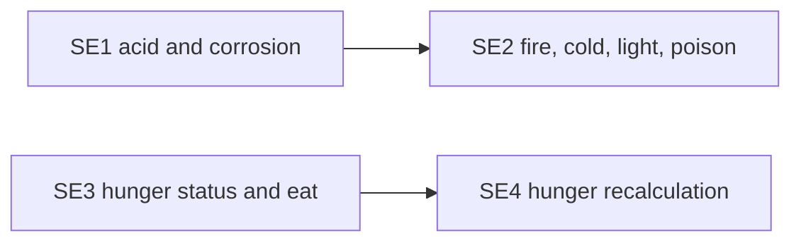

# Epic SE: Status Effects

Ports [effects.c](../../../src/effects.c) (219 lines) and
[player/hunger.rs](../../../src/player/hunger.rs) (formerly `player/hunger.c`).
The two halves
are independent and can run in parallel. Back to the
[backlog](../backlog.md).

Callers that must keep linking: `effects` functions are called from
`creature.c`, `spells.c`, and `traps.c`. Hunger functions are called from
`main_loop.c`, `stores.c`, `eat.c`, `quaff_potion.c`, `chakra.c`,
`divine.c`, `enter_house.c`, and Rust `player/player_extern.rs`.

## Story Graph

## Stories

### SE1. Acid and Corrosion (pathfinder: F-DMG)

Status: done. Depends on: none.
Size: M. Complexity: Medium. Agent: strong.

Owns: `minus_ac`, `corrode_gas`, and `acid_dam` in `effects.c`; a new Rust
effects module; a new F-DMG module (for example under `src/player/`);
registration lines.

Behavior: port `minus_ac` (shared armor damage), `corrode_gas`, and
`acid_dam` with their C symbols. They mutate worn items' `toac`, write
`inven_temp`, roll RNG, call `inven_damage`, `take_hit`, and `py_bonuses`,
and redraw stats.

Foundation: F-DMG. Thin Rust wrappers around C `take_hit`, `py_bonuses`,
`prt_stat_block`, and `inven_damage`, each with a short contract (what it
mutates, whether it can kill). Expose only what these three functions use.

Acceptance checks:

* L1: seeded `minus_ac` picks the same slot and lowers `toac` as C;
  resistant and absent items behave as in C.
* L1: acid damage with and without resistance gives the C HP change and
  messages.
* `creature.c`, `spells.c`, and `traps.c` still link.

Implemented in `src/effects/` with F-DMG wrappers in `src/player/damage.rs`.
Evidence: `cargo test effects::tests` and `make test-effects` cover seeded
armor selection, snapshots, resistance, HP, messages, inventory destruction,
stat redraws, invulnerability, and death flags. Interactive death, full gameplay,
and persistence are not verified by these checks. The other effects remain in C
for SE2.

### SE2. Fire, Cold, Light, and Poison (fan-out)

Status: open. Depends on: SE1.
Size: S. Complexity: Medium. Agent: standard.

Owns: the remaining functions in `effects.c`, its header, and the Rust
effects module.

Behavior: port `fire_dam`, `cold_dam`, `light_dam`, and `poison_gas` using
F-DMG, then delete `effects.c`.

Acceptance checks:

* L1: each effect, with and without the matching resistance, gives the C
  damage, inventory damage call, and messages for a fixed seed.
* `effects.c` is deleted; callers still link.

### SE3. Hunger Status and Eating (fan-out)

Status: done. Depends on: none.
Size: S. Complexity: Medium. Agent: standard.

Owns: `player_hunger_status`, `player_hunger_set_status`, and
`player_hunger_eat` in `hunger.c`; a new Rust hunger module under
`src/player/`; registration line.

Behavior: port food thresholds, status flag updates, and eating
(`foodc` changes, bloated messages with `randint`). Keep all C symbols.
`player_extern.rs` already declares `player_hunger_status`; switch it to the
Rust function.

Acceptance checks:

* L0: every threshold boundary maps to the same status as C.
* L1: eating near each boundary updates `foodc`, status, and messages as C
  for a fixed seed.

Implemented in `src/player/hunger.rs`; recalculation is also ported in SE4.
Evidence: focused Rust tests cover threshold boundaries, flag transitions,
negative food recovery, fullness messages, bloating, and gluttony. The C ABI
symbols remain available. Full hunger recalculation and gameplay turns are
not verified by these SE3 checks.

### SE4. Hunger Recalculation (fan-out)

Status: done. Depends on: SE3.
Size: S. Complexity: High. Agent: strong.

Owns: the rest of `hunger.c`, its header, and the Rust hunger module.

Behavior: port `player_hunger_recalculate`: digestion by weight, fainting
(`randint`, paralysis, stationary move via C `player_action_move`), and
starvation death (`death`, `moria_flag`, `died_from`). Delete `hunger.c`.

Acceptance checks:

* L1: seeded fainting and starvation set the same flags and messages as C.
* L1: normal digestion matches C for a few weights.
* `hunger.c` is deleted; `main_loop.c` still links.

Out of scope: running the main loop.

Implemented in `src/player/hunger.rs` with game-thread global access and the
unchanged C symbol in `src/player/hunger/`. The C source is removed; its
header remains for callers. Per-turn food consumption remains in `main_loop.c`.
Legacy behavior is preserved: weight loss happens only on entering weakness,
and both fainting paths require negative food.

Evidence: `cargo test player::hunger::tests` covers recalculation thresholds,
the hunger-item cap, truncated weight loss, starvation boundaries, and seeded
fainting/RNG consumption. `make test-hunger` passes against both the original C
implementation and the Rust port, checking real C callers, hunger messages,
rest/run interruption, stationary movement, paralysis, and starvation flags/cause.
It also checks seeded RNG reentry through sighted stationary movement.
The harness runs in `make check`. Full hunger gameplay turns, interactive
terminal rendering, and hunger-specific save restoration are not verified.
