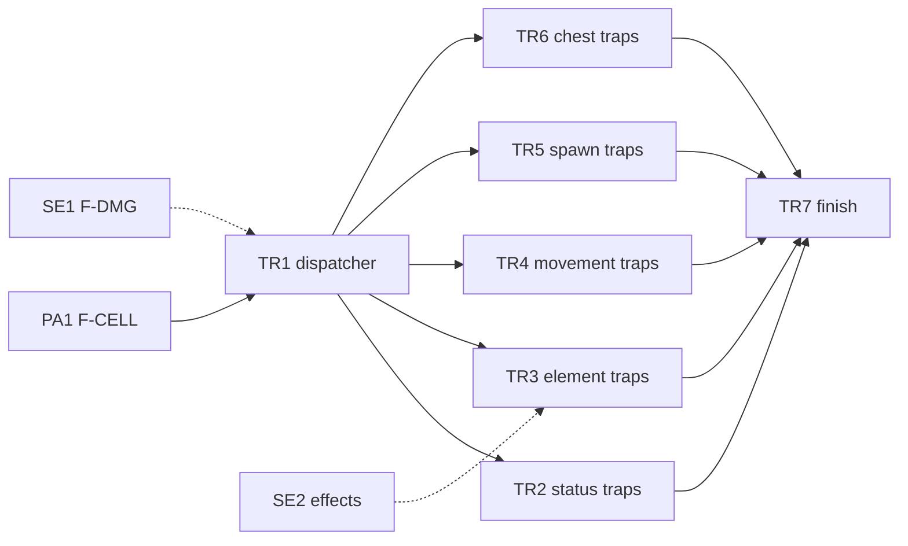

# Epic TR: Trap Activation

Ports the rest of [traps.c](../../../src/traps.c): the `hit_trap`
dispatcher, 22 `ht__*` handlers, town tile dispatch, and chest traps
(`trigger_trap`). Templates and placement are already Rust in
[dungeon/trap/](../../../src/dungeon/trap/). The C behavior every story must
preserve is in [C Behavior to Preserve](#c-behavior-to-preserve). Back to the
[backlog](../backlog.md).

Callers: `hit_trap` from [move.c](../../../src/player_action/move.c);
`trigger_trap` from `open.c` and `disarm_trap.c`. Both ABIs stay unchanged,
including `hit_trap(const long *y, const long *x)`.

## Story Graph



Fan-outs each own one Rust handler file and delete only their own `ht__*`
functions from `traps.c`.

The dispatcher goes first, not last, so the handlers can be ported in
parallel behind forwarding stubs. TR1 must characterize the dispatcher's
prelude and town dispatch before replacing it.

## C Behavior to Preserve

Verified against [traps.c](../../../src/traps.c) and
[traps.h](../../../src/traps.h) on 2026-10-09.

### ABI Contracts

```c
void hit_trap(const long *y, const long *x);
void trigger_trap(long y, long x);
void place_trap(long y, long x, long typ, long subval);
void change_trap(long y, long x);
void place_rubble(long y, long x);
```

* `hit_trap` takes pointers. A Rust export keeps `*const libc::c_long` and
  checks pointers before dereferencing.
* `trigger_trap` has no flags argument; it reads
  `t_list[cave[y][x].tptr].flags`.
* The existing Rust placement exports use `c_long`; `typ == 1` selects
  `TrapList::A` (unseen), anything else `TrapList::B` (seen). Open pits are
  always seen and subval 19 is always a closed door. Placement subvals are
  1-based (1-20). The wrappers cast to `usize` without validation; do not
  call them checked.
* Never define a Rust export while C still defines the same symbol.

### Dispatcher Prelude

Before dispatch, C `hit_trap` stops searching and resting, calls
`change_trap`, redraws the player's tile, clears `find_flag`, and rolls the
item's damage string. Keep this order.

### Dungeon Handlers

| Subval | C handler | Story |
| --- | --- | --- |
| 1 | `ht__open_pit` | TR1 |
| 2 | `ht__arrow` | TR1 |
| 3 | `ht__covered_pit` | TR4 |
| 4 | `ht__trap_door` | TR4 |
| 5 | `ht__sleep_gas` | TR2 |
| 6 | `ht__hidden_object` | TR5 |
| 7 | `ht__str_dart` | TR2 |
| 8 | `ht__teleport` | TR4 |
| 9 | `ht__rockfall` | TR5 |
| 10 | `ht__corrode_gas` | TR3 |
| 11 | `ht__summon_monster` | TR5 |
| 12 | `ht__fire` | TR3 |
| 13 | `ht__acid` | TR3 |
| 14 | `ht__poison_gas` | TR3 |
| 15 | `ht__blind_gas` | TR2 |
| 16 | `ht__confuse_gas` | TR2 |
| 17 | `ht__slow_dart` | TR2 |
| 18 | `ht__con_dart` | TR2 |
| 19 | `ht__secret_door` (empty; visibility handled earlier) | TR1 |
| 20 | `ht__chute` | TR4 |
| 99 | `ht__scare_monster` (empty for the player) | TR1 |
| 123 | `ht__whirlpool` | TR4 |

The covered pit calls `place_trap(y, x, 2, 1)` only in the non-feather-fall
branch, after damage.

### Town and Special Tiles

| Subval | C behavior |
| --- | --- |
| 101-107, 109, 110, 113, 116, 118 | `check_store_hours_and_enter` (general store, armory, weaponsmith, temple, alchemist, magic shop, inn, library, music shop, gem shop, deli, black market) |
| 108 | Trading-post hours, then `enter_trading_post` |
| 111 | Insurance closed: message only |
| 112 | Bank hours, then `enter_bank` |
| 114 | Money-changer hours, then a redirect-to-bank message |
| 115 | Casino hours, then `enter_casino` |
| 117 | `enter_fortress` |
| 119 | No case; falls through to the unknown-value message |
| 120-122 | `enter_house(*y, *x)` |

Unknown values print `You got lucky: unknown trap value.` Do not collapse
the special entrances into one generic store call.

### Chest Traps

`trigger_trap` reads the flags once and checks each bit with a separate
`if`, in this order. Combined flags apply all branches, including summons
after an explosion.

| Flag | Behavior |
| --- | --- |
| `0x10` | Strength-loss needle; damage if the stat loss succeeds |
| `0x20` | Poison needle damage and poison duration |
| `0x40` | Paralysis gas, unless free action |
| `0x80` | Delete the chest and apply explosion damage |
| `0x100` | Three summon attempts, water or land by terrain |

## Stories

### TR1. Rust Trap Dispatcher (pathfinder: F-TRAP-DISPATCH)

Status: implemented; TR1-TR5 are complete, with chest traps and final dispatch
cleanup still open.
Depends on: PA1. Recommended: SE1.
Size: M. Complexity: High. Agent: strong.

Owns: `traps.c` (dispatcher removal, making handlers non-static),
[traps.h](../../../src/traps.h), new files under `src/dungeon/trap/` for the
dispatcher and one handler file per group, and the registration line in
`dungeon/trap/mod.rs`.

Behavior: move `hit_trap` to Rust with the same pointer ABI and checked
dereferences. Keep the C prelude order: stop rest and search, `change_trap`,
redraw the tile, clear `find_flag`, then roll the item's damage with C
`damroll`. Town and special tiles (stores, trading post, bank, casino,
fortress, house) dispatch to their C entry functions. Port `ht__open_pit` and
`ht__arrow` to prove the handler pattern.

Foundation: F-TRAP-DISPATCH. Group files for TR2-TR5 keep effect fan-outs
independent of the dispatcher. Use F-DMG for damage if SE1 is done; otherwise
declare `take_hit` locally.

Acceptance checks:

* L1: each dungeon subval reaches its handler (forwarding or Rust), with
  the prelude side effects in C order.
* L1: open pit and arrow damage, feather fall, and miss cases match C.
* L1: town tile subvals call the right entry function, including 111, 114,
  missing 119, and unknown values; test with link-time doubles, not real
  stores.
* Null pointers are rejected without dereferencing.

Out of scope: porting store, bank, casino, fortress, or house entry.

Implemented in [activation.rs](../../../src/dungeon/trap/activation.rs),
[activation/globals.rs](../../../src/dungeon/trap/activation/globals.rs), and
[basic.rs](../../../src/dungeon/trap/basic.rs), using F-CELL and F-DMG.
The `status.rs`, `element.rs`, `movement.rs`, and `spawn.rs` group files
isolate handler behavior. TR5 is ported; its item placement and monster
summoning operations remain C boundaries. Secret-door and scare-monster
activation remain no-ops. The C chest dispatcher is unchanged.

Shared [ActivationKind](../../../src/model/activation_kind.rs) values name
both dungeon-trap and entrance subvals. Template data encodes these names
into the unchanged numeric item fields, and the global adapter decodes the
post-`damroll` subval before typed dispatch. Unhandled values (including 119
and the legacy building template 124) remain `Unknown(value)` and keep the
unknown-trap message. [StoreKind](../../../src/model/store.rs) names the
separate C `store_t` identifiers; only the C callback boundary converts them
to integers. Physical open/closed/secret door states remain `ItemType`
values, not activation kinds.

The pointer adapter rejects null coordinates, invalid/empty cells, invalid
hidden-trap template values, and unterminated damage strings with error
logging. Valid activations preserve the C prelude order and read the
replacement item after reveal.

Evidence: inline Rust tests cover pit damage/feather fall and arrow hit/miss
message order. [trap_dispatch_ffi.c](../../../tests/trap_dispatch_ffi.c)
characterizes the legacy dispatcher and checks the Rust C ABI, prelude,
forwarding arguments, and town routes with link-time doubles. `make test-traps`
is included in `make check`; this harness uses GNU linker wrapping and
explicitly skips non-Linux hosts. Real entrance UI, interactive trap gameplay,
trap-specific save/reload, and non-Linux C-caller characterization remain
unverified.

The harness initializes real equipment/armor state and uses seeded real hit
rolls rather than wrapping the Rust-owned armor accessors or `managed_to_hit`:
GNU `--wrap` does not redirect references resolved within the same object,
which can vary with architecture and incremental code generation. Arrow
checks cover hits, misses, and the RNG position after the hit check.
`CARGO_INCREMENTAL=0 make test-traps` exercises the non-incremental CI case.

### TR2. Status Traps (fan-out)

Status: implemented in Rust. Depends on: TR1.
Size: S. Complexity: Medium. Agent: standard.

Owns: the status-trap handler file and the matching `ht__*` functions in
`traps.c`.

Behavior: port sleep gas, blind gas, confuse gas, slow dart, strength dart,
and constitution dart. Includes free action, sustain, and `lose_stat` (C
`spells.c`) branches.

Acceptance checks:

* L1: each trap, with and without its resistance, sets the same flags and
  messages as C for a fixed seed.

Implemented in [status.rs](../../../src/dungeon/trap/status.rs). Rust unit
tests cover seeded duration ranges, free action, existing paralysis, hit/miss,
and sustained strength/constitution messages. `make test-traps` exercises the
global C ABI for all six activations and their flags/messages. C's `lose_stat`
remains the stat-loss operation; the six `ht__*` implementations were removed
from `traps.c`.

### TR3. Element Traps (fan-out)

Status: implemented in Rust using SE2 effect functions. Depends on: TR1. Recommended: SE2.
Size: S. Complexity: Low. Agent: standard.

Owns: the element-trap handler file and the matching `ht__*` functions.

Behavior: port fire, acid, corrode gas, and poison gas. Each calls an
`effects` function; call Rust if SE2 is done, otherwise C.

Acceptance checks:

* L1: each trap calls its effect with the C damage and message.

Implemented in [element.rs](../../../src/dungeon/trap/element.rs). Rust unit
tests verify each effect's damage/cause arguments and message order; the
`trap_dispatch_ffi.c` C-caller check validates the activated effect calls and
messages. The four `ht__*` handlers were removed from `traps.c` and `traps.h`.

### TR4. Movement and Level Traps (fan-out)

Status: complete. Depends on: TR1.
Size: S. Complexity: High. Agent: strong.

Owns: the movement-trap handler file and the matching `ht__*` functions.

Behavior: port covered pit, trap door, teleport, chute, and whirlpool. The
covered pit calls `place_trap(y, x, 2, 1)` only in the non-feather-fall
branch, after damage. Level changes set `dun_level` and `moria_flag`;
teleport sets `teleport_flag`.

Acceptance checks:

* L1: each trap's level, flag, and position changes match C, with and without
  feather fall.
* L1: the covered pit is replaced only in the non-feather-fall branch.

Implemented in [movement.rs](../../../src/dungeon/trap/movement.rs), with
injectable effects and the shared active RNG. Rust tests cover both feather-fall
branches, message/effect order, d6 descent, and repeated whirlpool descent.
The [C-caller checks](../../../tests/trap_dispatch_ffi.c) exercise all five
handlers through `hit_trap`, checking globals, unchanged player position,
damage causes, messages, seeded RNG consumption, and actual covered-pit
replacement. The five matching `ht__*` functions and declarations were removed.

### TR5. Spawning Traps (fan-out)

Status: implemented in Rust. Depends on: TR1.
Size: S. Complexity: Medium. Agent: standard.

Owns: the spawn-trap handler file and the matching `ht__*` functions.

Behavior: port hidden object, summon monster, and rockfall. Call C
`place_random_dungeon_item`, `pusht`, `delete_object`, and the monster summon
functions via FFI. Rockfall uses Rust `place_rubble`.

Acceptance checks:

* L1: seeded summon count and calls match C; use link-time doubles for
  monster placement.
* L1: hidden object and rockfall leave the cell and `t_list` as in C.

Implemented in [spawn.rs](../../../src/dungeon/trap/spawn.rs). The C effect
handlers were removed; Rust retains the C item-placement and monster-summon
boundaries, while rockfall uses Rust `place_rubble`. The C-caller test verifies
trap-cell updates, item-list operations, messages, damage ordering, water/land
summon routing, and seeded summon counts.

### TR6. Chest Traps (fan-out)

Status: implemented. Depends on: TR1.
Size: S. Complexity: Medium. Agent: standard.

Owns: `trigger_trap` in `traps.c`, a new chest-trap Rust file, and its
prototype in `traps.h`.

Behavior: port `trigger_trap(long y, long x)`. Reads chest flags from
`t_list[cave[y][x].tptr].flags`; applies lose-strength, poison, paralysis,
explode, and summon in C order.

Acceptance checks:

* L1: each flag bit, alone and combined, matches C state and messages for a
  fixed seed.
* `open.c` and `disarm_trap.c` still link without changes.

Implemented in [chest.rs](../../../src/dungeon/trap/chest.rs). Raw item flags
are decoded into a typed `ChestTraps` snapshot before applying effects. The C ABI
wrapper is in [interop.rs](../../../src/dungeon/trap/interop.rs); `traps.c`
no longer defines `trigger_trap`. Rust unit tests cover each flag, resistance,
and combined-effect ordering. The C-caller check exercises the ABI, seeded
damage and durations, chest deletion, terrain-specific summons, and messages.

### TR7. Remove traps.c (finish)

Status: implemented. Depends on: TR2-TR6.
Size: S. Complexity: Low. Agent: light.

Owns: `traps.c`, `traps.h`, and the forwarding code.

Behavior: delete `traps.c` once empty, remove forwarding stubs, and keep
`traps.h` prototypes for C callers.

Acceptance checks:

* `make check` passes after a clean build.
* No `ht__` symbols remain in C.

Implemented: `traps.c` is deleted. By TR7 it held only includes and prototypes
for Rust-defined functions, and the stale `traps.o` was removed by `make clean`
before deletion. [traps.h](../../../src/traps.h) keeps the prototypes for C
callers. `make clean && make check` passed with 773 Rust tests and the C
harnesses. `test-traps` skips on non-Linux hosts, so the GNU `--wrap` C-caller
checks did not run here. The linked binary defines each trap entry point once
and contains no `ht__` symbols.
